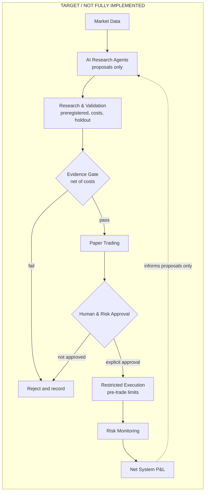
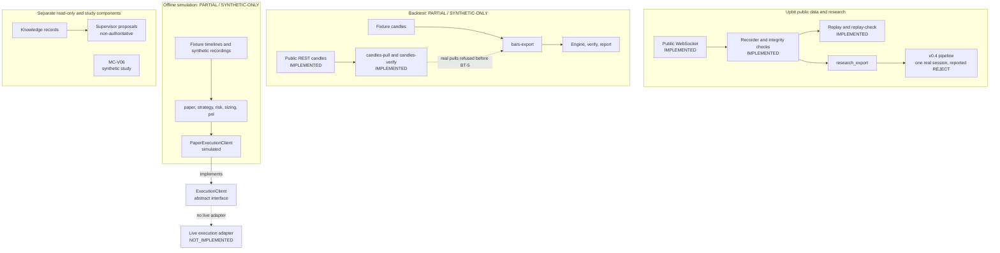
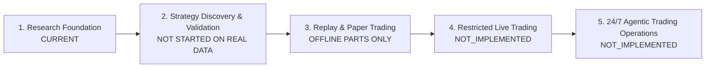

<div align="center">

# MoneyLab — Evidence-Driven Quantitative Research toward Agentic Trading

MoneyLab is a Python research and engineering project working toward a long-term goal:
a 24/7, AI-assisted trading system that may trade only when evidence shows positive net
results after all costs, within separately approved limits.

**Current status: Research & Engineering. Live trading is neither implemented nor authorized. Profitability has not been demonstrated.**


[Target](#target-architecture) · [Status](#current-project-status) · [Findings](#research-findings) · [Roadmap](#roadmap) · [Quick Start](#quick-start) · [Docs](#documentation)

</div>

## At a Glance

| | |
|---|---|
| **Long-term goal** | An evidence-driven, AI Agent-based 24/7 trading system |
| **Current stage** | Research & Engineering |
| **Research focus** | Upbit KRW-BTC public market data |
| **Built today** | Market data capture and replay, a cost-aware backtest engine (synthetic data so far), statistical validation tools, read-only knowledge records and research proposals |
| **Engineering focus** | Data pipelines, reproducibility, testable architecture, research integrity, controlled AI-assisted development |
| **Candidate next steps** | Resolve the open statistical validation issue, freeze a preregistration, run a first real-data backtest. Each step needs separate approval |
| **Live trading** | Not implemented, not authorized |
| **Profitability** | Not demonstrated |

## Why MoneyLab Exists

Strategy backtests are easy to make look profitable: too many variants are tried, test data is reused, costs are
underestimated and future information leaks into past decisions. MoneyLab treats "is there a net edge after costs?"
as a hypothesis test and builds the infrastructure to answer it honestly, including when the answer is no.

The long-term economic criterion is system-level net profit, not a promising chart:

```text
Net system P&L = realized trading P&L after execution costs
                 − incremental AI, data, infrastructure and operating costs
```

When fill prices already include spread and slippage, those costs are not deducted twice.

## Target Architecture

**TARGET / NOT FULLY IMPLEMENTED.** This diagram shows the long-term goal, not the current system.



AI Agents may propose and monitor. They cannot authorize capital or live trading, override limits or promote their
own results to verified evidence. Performance feedback may inform new research proposals, but it does not authorize
strategy changes or deployment. Any new proposal must pass the same gates again, and any live trading would need a
separate Work Order and explicit human approval.

## Current Project Status

Implementation status is not evidence of profitability.

| Capability | Status | Evidence |
|---|---|---|
| Upbit public WebSocket recording | IMPLEMENTED | `src/moneylab/providers/upbit/recorder/`, `tests/test_upbit_recorder.py` |
| Upbit public REST candle collection | IMPLEMENTED | `src/moneylab/providers/upbit/candles.py`, `tests/test_upbit_candles.py`, `tests/test_upbit_candles_verify.py` |
| Shared recording core, integrity checks, replay | IMPLEMENTED | `src/moneylab/recording/`, `tests/test_upbit_replay.py` |
| v0.4 research pipeline | IMPLEMENTED | `src/moneylab/research/`, `tests/test_research_pipeline.py`, `tests/test_research_leakage.py` |
| MC-V06 Monte Carlo study (synthetic results) | IMPLEMENTED | `src/moneylab/research/v06/`, `tests/test_v06_montecarlo.py` |
| Post-hoc futility diagnostics | PARTIAL / SYNTHETIC-ONLY | `src/moneylab/research/v06/futility_diag.py`, `tests/test_v06_futility_diag.py`; not a completed formal validation |
| Research report conformance checks (structure only) | IMPLEMENTED | `src/moneylab/research/report_conformance.py`, `tests/test_research_report_conformance.py` |
| Knowledge records and context resolver (read-only) | IMPLEMENTED | [knowledge/SCHEMA.md](knowledge/SCHEMA.md), `tests/test_knowledge_context.py` |
| Supervisor proposals (non-authoritative) | IMPLEMENTED | [proposal contract](docs/supervisor_proposal_contract.md), `tests/test_supervisor_isolation.py` |
| Backtest engine BT-1 to BT-3e | PARTIAL / SYNTHETIC-ONLY | `src/moneylab/backtest/`, `tests/test_backtest_vault.py`, `tests/test_bar_export.py` |
| Offline order-book simulation and kill switch | PARTIAL / SYNTHETIC-ONLY | `src/moneylab/paper/`, `src/moneylab/risk/`, `tests/test_paper_engine.py`, `tests/test_kill_switch.py` |
| Polymarket provider and scanner (fixtures only) | PARTIAL / SYNTHETIC-ONLY | `src/moneylab/providers/polymarket/`, `src/moneylab/scanner/`, `tests/test_scanner.py` |
| `ExecutionClient` interface | DESIGN_ONLY | `src/moneylab/execution/base.py`; abstract interface |
| `PaperExecutionClient` | PARTIAL / SYNTHETIC-ONLY | `src/moneylab/paper/engine.py`, `tests/test_paper_engine.py`; simulation only |
| Live execution adapter | NOT_IMPLEMENTED | Design only: [live execution design](docs/live_execution_design.md) |
| v0.6 preregistration, BT4 | DESIGN_ONLY | [v0.6 draft](docs/research_v06_preregistration_draft.md), [BT4 design](docs/bt4_design_01.md) |
| Policy and risk engine for live operation | PLANNED | [ARCHITECTURE.md](ARCHITECTURE.md) section 8 |
| Real-time Paper Trading | PLANNED | Not validated; [ARCHITECTURE.md](ARCHITECTURE.md) section 8 |
| Real-data backtest (BT-5) | NOT_IMPLEMENTED | Not started; `bars-export` refuses real pulls |
| AI autonomous research loop | NOT_IMPLEMENTED | [ARCHITECTURE.md](ARCHITECTURE.md) section 8 |
| Live trading | NOT_IMPLEMENTED | No order path; [ARCHITECTURE.md](ARCHITECTURE.md) section 3 |
| v0.4 raw data, results and test-split status | NOT_VERIFIED | Reported in project documents; run data is not in Git. See [Research Findings](#research-findings) |

## Current Architecture

This diagram shows what exists today. Dashed lines mark a boundary, not a working connection.



Module-level dependencies and maturity labels are in [ARCHITECTURE.md](ARCHITECTURE.md).

## Research Findings

**Real data: v0.4 microstructure study (reported result).** Project documents report one 6-hour Upbit KRW-BTC session.
On train and validation data, order-book features showed statistically significant signals, but the predicted moves
were far smaller than costs: maximum gross 1.2 bp against assumed round-trip costs of 52–55 bp (an assumed 25 bp fee
per side plus spread, not a confirmed account cost). Of 116 feature/horizon combinations, 112 were `NEGATIVE_EVIDENCE`
(REJECT), 4 `RESEARCH_MORE` and 0 `PAPER_CANDIDATE`. Statistical significance did not mean economic usefulness.
[Source](docs/research_v05_preregistration_draft.md)

**Evidence limits.** Raw data and run outputs are not stored in Git, so these numbers cannot be independently
re-verified from this repository. Project records indicate the locked test split was not opened
(`tests/test_repo_hygiene.py`), but that check is skipped in CI, so this cannot be independently confirmed from Git
either. The result comes from a single session. It does not generalize to other horizons or market regimes, and it
is not evidence of profitability.

**Synthetic data: software validation only.** The backtest pipeline runs on synthetic fixtures and is labelled
`SYNTHETIC / NOT_EVIDENCE`. It shows software behaviour, not market edge.

**Procedure validation: MC-V06.** Monte Carlo checks of the v0.6 decision procedures found the futility procedure
anti-conservative at the boundary (it rejected more often than nominal) in synthetic settings. The cause is
unresolved. [Evidence review](docs/research_bt4_01_evidence_review.md)

**Open work.** BT4 remains design only: no v0.6 freeze or BT4 implementation has been performed. A post-hoc futility
diagnostic record exists; it publishes no result values and is not a completed formal validation.
[Report](docs/bt4_futility_diag_report.md) The v0.6 preregistration is a draft. BT-5 has not started. Real-time Paper Trading is not validated. The account fee is unconfirmed, so
decisions use a conservative 25 bp assumption.

**Future research candidates.** On-chain wallet analysis is `FUTURE RESEARCH / UNVERIFIED IDEA`
([idea note](docs/research-intake/2026-11-06/WALLET_INTELLIGENCE_IDEA.md)). It is not a verified signal or an
implementation plan.

## Roadmap



| Stage | Goal | Main deliverables | Status | To move on (proposed) |
|---|---|---|---|---|
| 1. Research Foundation | Reproducible data and validation base | Capture, replay, backtest engine, statistics, knowledge records | Mostly built; statistical issue open | Reproducible tests; statistical issue handled; preregistration frozen |
| 2. Strategy Discovery & Validation | Decide on strategies after costs | Daily long/cash candidates, real-data evaluation | BT-5 not started | Leakage-controlled out-of-sample net result; robustness and capacity review |
| 3. Replay & Paper Trading | Test operating conditions | Real-time paper service, ledger, fill gap measurement | Offline parts only | Stable paper operation; reconciliation; drawdown and outage controls |
| 4. Restricted Live Trading | Prove behaviour with bounded capital | Risk engine, execution adapter, credential isolation | Not implemented | Separate Work Order; explicit human approval; legal and API review; bounded tests |
| 5. 24/7 Agentic Trading Operations | Long-term operation with AI-assisted research | Monitoring, cost accounting, agent authority limits | Not implemented | Ongoing: net system P&L after all costs; monitored safety |

No dates or return targets are promised. Failing a gate means stop, diagnose or reject, not automatic promotion.

## Engineering Highlights

| Capability | What exists | Where |
|---|---|---|
| Data pipelines | Public data capture, integrity checks, deterministic replay | `src/moneylab/providers/upbit/`, `src/moneylab/recording/` |
| Testable architecture | Dependency rules enforced by tests | `tests/test_architecture_and_cli.py`, `tests/test_backtest_architecture.py` |
| Research integrity | SHA-256 pinned preregistration, one-time test split, holdout vault | `src/moneylab/research/`, `src/moneylab/backtest/vault.py` |
| Statistics | Block bootstrap, HAC, FDR, Holm / IUT, Monte Carlo checks reported with failures | `src/moneylab/research/`, [evidence review](docs/research_bt4_01_evidence_review.md) |
| Reproducibility | Atomic writes, manifests, read-only verify commands, pinned dependencies | `src/moneylab/storage/`, `requirements.txt` |
| Quality | Offline tests, ruff and scoped mypy on Windows CI; experimental Linux job (non-blocking) | [ci-tests.yml](.github/workflows/ci-tests.yml) |
| Safety engineering | Secret redaction, public-data-only Upbit adapter tests, offline kill switch | `src/moneylab/core/redaction.py`, `tests/test_architecture_and_cli.py` |
| Agent governance | Immutable Work Orders, human gates, fail-closed guard | [docs/tasks](docs/tasks/README.md), [workflow](docs/agent_workflow.md) |

An offline kill switch exists for simulations. It is not a live risk-management system.

## Quick Start

### Getting Started

Python 3.12 or newer is required (verified on 3.14.8). Offline commands need no secrets.

```powershell
python -m venv .venv
.\.venv\Scripts\Activate.ps1
pip install -r requirements-dev.txt
pip install -e . --no-deps

python -m pytest                              # offline test suite
python -m moneylab scan --source fixture      # scanner on synthetic sample data
python -m moneylab backtest --help            # backtest CLI
```

### Synthetic Backtest Demo

`SYNTHETIC / NOT_EVIDENCE`: this demonstrates pipeline reproducibility, not strategy profitability.

```powershell
python examples/synthetic_backtest_demo.py
```

Reports require a clean Git checkout; otherwise the demo stops after verification with `PARTIAL_CODE_STATE_UNPINNED`.

## AI-assisted Engineering & Safety

Claude Code is used as an engineering assistant. Design decisions, approvals and final judgment remain with the author.
The controls below were introduced progressively, so earlier commits predate some of them.

```text
Research / Design → Work Order → Human Gate Authorization → Claude Code → Tests / Audit → PR / CI / Merge
```

`Proposal ≠ Work Order ≠ Approval ≠ Execution`

These controls govern how an AI coding agent changes this repository. They are not capital approval, live-trading
authorization or a runtime risk engine. The guard is one text-matching layer, not a sandbox.

## Documentation

- [ARCHITECTURE.md](ARCHITECTURE.md): current architecture and maturity labels
- [docs/backtest_design.md](docs/backtest_design.md): backtest design
- [docs/live_execution_design.md](docs/live_execution_design.md): design only, not implemented
- [docs/research-intake/2026-11-06/README.md](docs/research-intake/2026-11-06/README.md): non-authoritative research notes; not requirements, implementation approval or evidence of profitability
- [docs/tasks/README.md](docs/tasks/README.md): Work Order contract
- [CLAUDE.md](CLAUDE.md): rules for the coding assistant
- [docs/history/README_v0.1-v0.4.md](docs/history/README_v0.1-v0.4.md): development history (original notes)

## Limitations & License

- Not a production trading system today. There is no live order path.
- No profitability claim. Backtest results so far are synthetic; the only real-data study reported so far was rejected after costs.
- Statistical procedures are still being validated, and the v0.6 preregistration is not frozen.
- Polymarket appears only as earlier work: its public API returned HTTP 451 in the development environment and the
  cause was not determined. No bypass is implemented. Other markets are possibilities, not work in progress.
- AI-generated proposals cannot authorize trades.

[MIT](LICENSE) © 2026 Son Woo Kyu
