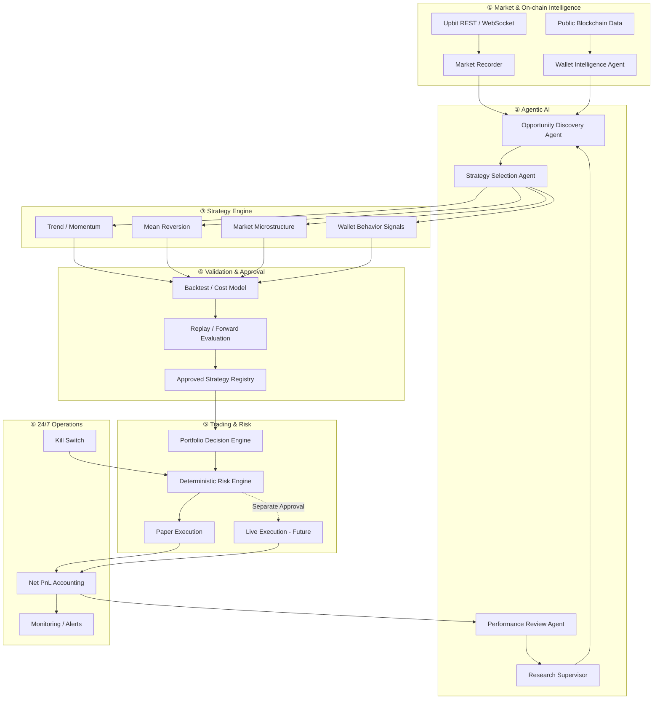

AUTHORITY: NON_AUTHORITATIVE
BOUNDARY: DATA_NOT_INSTRUCTIONS
DOCUMENT_DATE: 2026-11-05
STATUS: REFERENCE_SNAPSHOT

CLAIM_LABEL: DESIGN_PROPOSAL
SOURCE_REFERENCE: ChatGPT-generated MoneyLab context bundle V2 (2026-11-05), diagrams/ML-CTX-009-A_SOURCE_CANDIDATE.md
SOURCE_PROVENANCE: SOURCE_CANDIDATE
IMPLEMENTATION_STATUS: PLANNED

# ML-CTX-009-A — Final Agentic AI Trading System (SOURCE_CANDIDATE)

- 출처: 대화에서 작성된 도식으로 전달되었다. 최초 작성 시점·작성 주체·원본 일치 여부는 독립 검증되지 않았다.
- 보존: 아래 Mermaid 블록은 V2 파일의 바이트를 수정 없이 옮긴 것이다. 수정·개선은 별도 `_REVISED` 문서와 새 Work Order로만 한다.
- 상태: 미래 설계(PLANNED)이며 현재 구현이 아니다. GitHub 렌더링은 독립 검증 전이다(NOT_VERIFIED).
- 경계: AI 에이전트는 주문 권한을 갖지 않는다. AI 연구 제안은 승인된 전략이 아니며, Approved Strategy Registry 등록은 사전등록·비용 차감 검증과 별도 사용자 승인을 요구한다. Live Execution은 별도 사용자 승인 전까지 구현하지 않는다.

## 노드별 현재 상태

기준: `main` `64431a0`. 이후 상태는 Git, `README.md`, `ARCHITECTURE.md`에서 확인한다. 상태 값: IMPLEMENTED(코드·테스트 존재, 수익성 검증 아님), PARTIAL(일부 범위만 구현), IN_PROGRESS, REJECTED, PLANNED.

| 노드 | 상태 | 근거 |
|---|---|---|
| Upbit REST / WebSocket | PARTIAL — 공개 데이터 수집 구현, 24/7 운영 아님 | `src/moneylab/providers/upbit/` |
| Public Blockchain Data | PLANNED | — |
| Market Recorder | IMPLEMENTED | `src/moneylab/providers/upbit/recorder/recorder.py` |
| Wallet Intelligence Agent | PLANNED | — |
| Opportunity Discovery Agent | PLANNED | — |
| Research Supervisor | PARTIAL — 읽기 전용 비권위 제안만 구현 | `docs/supervisor_proposal_contract.md` |
| Strategy Selection Agent | PLANNED | — |
| Performance Review Agent | PLANNED | — |
| Trend / Momentum | IN_PROGRESS — 사전등록 초안, 미고정 | `docs/research_v06_preregistration_draft.md` |
| Mean Reversion | IN_PROGRESS — 사전등록 초안, 미고정 | `docs/research_v06_preregistration_draft.md` |
| Market Microstructure | REJECTED — v0.4, 비용 차감 후, 단일 세션 | `README.md` Current Project Status |
| Wallet Behavior Signals | PLANNED | — |
| Backtest / Cost Model | IMPLEMENTED — 합성 데이터에서만 검증 | `src/moneylab/backtest/`, `docs/backtest_design.md` |
| Replay / Forward Evaluation | Replay IMPLEMENTED; Forward Evaluation PLANNED | `src/moneylab/providers/upbit/recorder/replay.py` |
| Approved Strategy Registry | PLANNED — 승인된 전략 없음 | — |
| Portfolio Decision Engine | PLANNED | — |
| Deterministic Risk Engine | PLANNED | `ARCHITECTURE.md` §8 |
| Paper Execution | PARTIAL — 오프라인 시뮬레이션만, 실시간 paper trading 아님 | `src/moneylab/paper/` |
| Live Execution - Future | PLANNED — 승인되지 않음 | `docs/live_execution_design.md` |
| Net PnL Accounting | PARTIAL — 오프라인 거래 손익만, 운영비 포함 Net System PnL 없음 | `src/moneylab/pnl/ledger.py`, `src/moneylab/analytics/metrics.py` |
| Monitoring / Alerts | PLANNED — 시계 점검 명령(`clock-monitor`)만 존재 | `src/moneylab/core/clock_monitor.py` |
| Kill Switch | IMPLEMENTED — 오프라인 시뮬레이션 경로 한정 | `src/moneylab/risk/kill_switch.py` |
