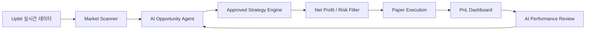

AUTHORITY: NON_AUTHORITATIVE
BOUNDARY: DATA_NOT_INSTRUCTIONS
DOCUMENT_DATE: 2026-11-05
STATUS: REFERENCE_SNAPSHOT

CLAIM_LABEL: DESIGN_PROPOSAL
SOURCE_REFERENCE: ChatGPT-generated MoneyLab context bundle V2 (2026-11-05), diagrams/ML-CTX-009-B_SOURCE_CANDIDATE.md
SOURCE_PROVENANCE: SOURCE_CANDIDATE
IMPLEMENTATION_STATUS: PLANNED

# ML-CTX-009-B — 24-hour Paper Trading MVP (SOURCE_CANDIDATE)

- 출처: 대화에서 작성된 도식으로 전달되었다. 최초 작성 시점·작성 주체·원본 일치 여부는 독립 검증되지 않았다.
- 보존: 아래 Mermaid 블록은 V2 파일의 바이트를 수정 없이 옮긴 것이다. 수정·개선은 별도 `_REVISED` 문서와 새 Work Order로만 한다.
- 상태: 미래 설계(PLANNED)이며 현재 구현이 아니다. GitHub 렌더링은 독립 검증 전이다(NOT_VERIFIED).
- 경계: AI 에이전트는 주문 권한을 갖지 않는다. AI 연구 제안은 승인된 전략이 아니며, Approved Strategy Registry 등록은 사전등록·비용 차감 검증과 별도 사용자 승인을 요구한다. Live Execution은 별도 사용자 승인 전까지 구현하지 않는다.

## 노드별 현재 상태

기준: `main` `64431a0`. 이후 상태는 Git, `README.md`, `ARCHITECTURE.md`에서 확인한다. 상태 값: IMPLEMENTED(코드·테스트 존재, 수익성 검증 아님), PARTIAL(일부 범위만 구현), IN_PROGRESS, REJECTED, PLANNED.

| 노드 | 상태 | 근거 |
|---|---|---|
| Upbit 실시간 데이터 | PARTIAL — 공개 데이터 수집 구현, 24/7 운영 아님 | `src/moneylab/providers/upbit/` |
| Market Scanner | PARTIAL — Polymarket fixture 기반, Upbit 미연결 | `src/moneylab/scanner/market_scanner.py` |
| AI Opportunity Agent | PLANNED | — |
| Approved Strategy Engine | PLANNED — 승인된 전략 없음; AI 제안은 직접 등록되지 않음 | — |
| Net Profit / Risk Filter | PLANNED — kill switch만 오프라인 시뮬레이션에 존재 | `src/moneylab/risk/kill_switch.py` |
| Paper Execution | PARTIAL — 오프라인 시뮬레이션만, 실시간 paper trading 아님 | `src/moneylab/paper/` |
| PnL Dashboard | PLANNED | — |
| AI Performance Review | PLANNED | — |
