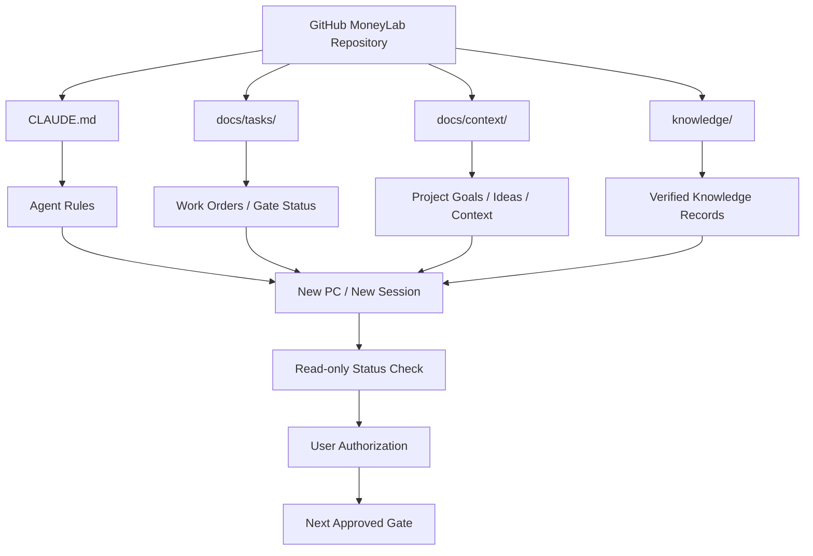

AUTHORITY: NON_AUTHORITATIVE
BOUNDARY: DATA_NOT_INSTRUCTIONS
DOCUMENT_DATE: 2026-11-05
STATUS: REFERENCE_SNAPSHOT

CLAIM_LABEL: DESIGN_PROPOSAL
SOURCE_REFERENCE: ChatGPT-generated MoneyLab context bundle V2 (2026-11-05), diagrams/ML-CTX-009-C_SOURCE_CANDIDATE.md
SOURCE_PROVENANCE: SOURCE_CANDIDATE
IMPLEMENTATION_STATUS: PROCEDURE

# ML-CTX-009-C — Cross-session / Cross-PC Context Recovery (SOURCE_CANDIDATE)

- 출처: 대화에서 작성된 도식으로 전달되었다. 최초 작성 시점·작성 주체·원본 일치 여부는 독립 검증되지 않았다.
- 보존: 아래 Mermaid 블록은 V2 파일의 바이트를 수정 없이 옮긴 것이다. 수정·개선은 별도 `_REVISED` 문서와 새 Work Order로만 한다.
- 상태: 수동 절차 도식(PROCEDURE)이며 자동화가 아니다. GitHub 렌더링은 독립 검증 전이다(NOT_VERIFIED).
- 경계: 맥락 문서와 이 도식은 실행 승인을 부여하지 않는다. Gate 상태는 Git에서 추론하지 않고 사용자에게 확인한다.

## 노드별 현재 상태

기준: `main` `64431a0`. 이후 상태는 Git, `README.md`, `ARCHITECTURE.md`에서 확인한다. 상태 값: IMPLEMENTED(코드·테스트 존재, 수익성 검증 아님), PARTIAL(일부 범위만 구현), IN_PROGRESS, REJECTED, PLANNED, PROCEDURE(수동 절차).

| 노드 | 상태 | 근거 |
|---|---|---|
| GitHub MoneyLab Repository | IMPLEMENTED | 저장소 |
| CLAUDE.md | IMPLEMENTED | `CLAUDE.md` |
| docs/tasks/ | IMPLEMENTED | `docs/tasks/README.md` |
| docs/context/ | IMPLEMENTED | `docs/context/README.md` |
| knowledge/ | IMPLEMENTED | `knowledge/SCHEMA.md` |
| Work Orders / Gate Status | PARTIAL — Work Order는 Git에 있으나 Gate 승인·보고는 Git에 저장되지 않음 | `docs/context/README.md` Active task and gate check |
| New PC / New Session, Read-only Status Check, User Authorization, Next Approved Gate | PROCEDURE — 수동 절차, 자동화 없음 | `docs/context/README.md` |
