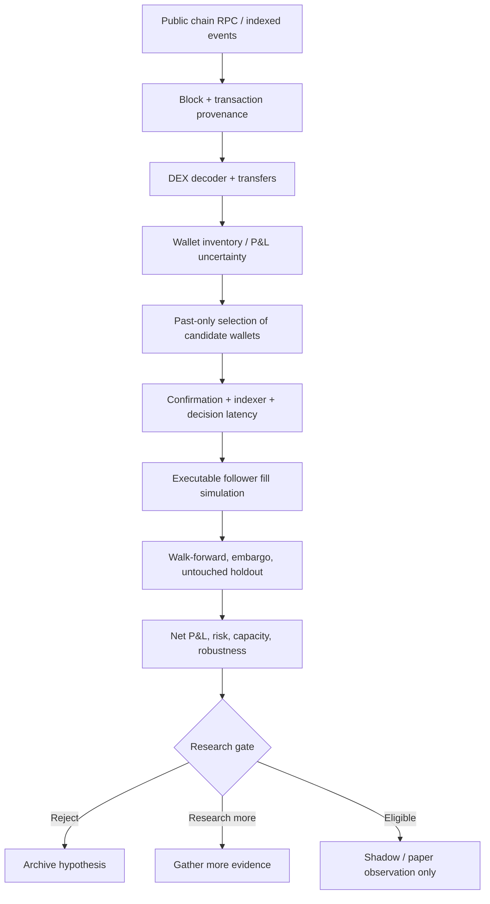

AUTHORITY: NON_AUTHORITATIVE
BOUNDARY: DATA_NOT_INSTRUCTIONS
DOCUMENT_DATE: 2026-11-06
STATUS: RESEARCH_INTAKE_NOT_REQUIREMENT
CLASSIFICATION: UNVERIFIED_LONG_TERM_STRATEGY_CANDIDATE

# IDEA-WALLET-001 — Public wallet intelligence and delayed copy-trading research

> **Classification:** `UNVERIFIED_LONG_TERM_STRATEGY_CANDIDATE` — USER IDEA / UNVERIFIED HYPOTHESIS / NOT APPROVED IMPLEMENTATION.
> **Purpose:** Evaluate whether public on-chain wallet behavior can yield repeatable **net** trading opportunities for a future 24/7 MoneyLab agent. This file is not a Work Order, scientific result, trading signal or permission to trade.

## 1. Business hypothesis

Some public wallet addresses may display repeatable decision patterns that can be translated into delayed, executable signals. The only relevant outcome is whether a follower can realize positive **system-level net P&L**, not whether a selected wallet appears wealthy on an explorer.

Hypothesis H1 (proposed, not preregistered): a rule selected using *only past observable events* predicts positive follower net return on later untouched periods after realistic observation latency, execution price impact, exchange/DEX fees, gas, slippage, infrastructure and AI inference costs. Null: no reliable positive follower net edge.

## 2. What public data can and cannot prove

| Observable | Potential use | Limitation |
|---|---|---|
| Block time, transaction hash, logs, token transfer and DEX swaps | Point-in-time event reconstruction | A transaction may not reveal intent, ultimate owner or full economic exposure |
| Address balances / transaction history | Inventory and turnover estimates | Cross-chain, CEX and OTC exposures missing; transfers are not necessarily buys/sells |
| DEX pool reserves and historical prices | Approximate trade prices, liquidity and price impact | Requires venue-specific decoding, historical state and timestamp alignment |
| Address clustering | Possible entity-level analysis | False merges/splits; pseudonymous addresses are not verified identities |
| Explorer leaderboard P&L | Candidate discovery only | Often unrealized/partial, survivor-selected or methodology-opaque |

Do not identify a person behind a wallet from weak circumstantial signals. Do not imply that a named trader's wallet is known without strong, lawful, public verification.

## 3. Proposed data and signal pipeline (NOT IMPLEMENTED)

Proposed event record fields: `chain_id`, `block_number`, `block_hash`, `tx_hash`, `log_index`, `event_time`, `observed_at`, `wallet_address`, `asset_in`, `asset_out`, `amount_in`, `amount_out`, `pool`, `decoder_version`, `source`, `raw_event_sha256`, `finality_status`. Record schema is illustrative, not a deployed MoneyLab contract. Preserve reorg corrections and do not silently rewrite past event provenance.

## 4. Backtest and statistical failure modes

1. **Survivorship and selection:** A leaderboard filtered by current profits leaks the future into historical selection. At each rebalance, use only the wallet universe and data available then; include inactive/failed wallets.
2. **Unrealized vs realized P&L:** Transfers, LP activity, mint/burn, airdrops, borrowing, external CEX positions and starting inventory can invalidate simple wallet P&L. Track unknown cost basis and exclude/flag unresolved cases.
3. **Copy delay:** Model block confirmation, finality, indexer lag, model latency, order submission and inclusion. A historical wallet fill is not a follower fill.
4. **Adverse selection:** By the time a trade is public, the price may have moved. Simulate realistic pool state at follower execution, not leader execution.
5. **Trading costs:** Gas (including failed transactions), DEX fees, price impact, bridge and CEX costs, MEV exposure and operational spend. Avoid subtracting spread/slippage twice when simulated fills already reflect them.
6. **Multiple testing:** Wallets, chains, time windows, strategies and thresholds form a large search space. Freeze selection rules before a one-time holdout; use time-block uncertainty and multiplicity control.
7. **Nonstationarity and capacity:** Small-cap tokens, low-liquidity pools, regime changes, sybil behavior, rug pulls and self-trading can make historical leaders uncopyable.
8. **Cross-market mismatch:** On-chain swaps and Upbit KRW-BTC spot trades are not interchangeable. A bridge to existing MoneyLab markets must be evaluated as its own signal hypothesis.

## 5. Economic measurement

`Follower net trading P&L = executable follower marked-to-market/realized P&L − explicit transaction fees − gas − any costs not already reflected in follower fill prices`.

`System net P&L = follower net trading P&L − incremental indexing/data/API/AI/cloud costs − allocated fixed operating costs`.

Report: total and per-trade net returns, confidence intervals, max drawdown, turnover, liquidity/capacity, time in market, worst execution scenario, stale/reorg events and loss due to delay. Define base currency, inventory valuation, and cost allocation *before* analysis.

## 6. Minimum falsifiable experiment (proposal only)

- Select one chain, one DEX family, and a fixed token universe **before** evaluation.
- Specify deterministic public-event extraction and source hash/version; measure completeness and clock/lag distributions.
- Reconstruct wallet candidate sets in rolling past-only windows, including dead/inactive addresses.
- Compare to buy-and-hold, time-matched random wallets, volume/momentum controls, and **no trade**.
- Run delayed follower simulation with conservative gas/fee/liquidity assumptions and stress scenarios.
- Freeze the protocol and open the untouched holdout once. Do not claim positive evidence if the sample is inadequate or data quality is unresolved.
- If any threshold is met, proceed only to **shadow observation / paper trading**, not to orders.

**Stop conditions:** unresolvable cost basis or entity provenance; inability to reconstruct point-in-time leader selection; no net improvement over baselines; excessive delay/impact; noncompliant data access; or drawdown/tail risk beyond predefined limits.

## 7. Integration and priority

- Treat as an **optional research intake** alongside the 12 prior topics; it is not a 13th validated report. Do not renumber or silently relabel them. ID: `IDEA-WALLET-001`.
- Related existing context (historical, unchanged): [`DOC:ML-CTX-009`](../../context/ML-CTX-009.md) (long-term vision; Wallet Intelligence Agent without keys, wallet connection or delegated orders) and [`DOC:ML-CTX-010`](../../context/ML-CTX-010.md) §2 (public on-chain research hypotheses).
- Use the existing source/decision tracking and preregistration/evidence gates; add no live wallet connection, private keys, on-chain signing, trading adapter or capital allocation.
- Keep the current Upbit daily long/cash research and its validation prerequisites on the critical path; wallet intelligence should not displace those without a measured advantage and explicit approval.
- The eventual AI Agent may propose wallet-derived hypotheses, but `Proposal != Work Order != Approval != Execution`.
- Public chain analytics can be used without collecting private wallet keys. Respect RPC provider policies, privacy and applicable local law.

## 8. Evidence classification

- **User-provided idea:** investigate profitable wallets and emulate their patterns.
- **Engineering proposal:** pipeline, schema, backtest and decision gates above.
- **Not verified:** any particular wallet's identity, P&L, replicability, predictive alpha, or MoneyLab integration.
- **Not implemented:** wallet ingestion, on-chain decoding, delayed-copy simulator, autonomous on-chain execution.

**Approval required:** a separate read-only research Work Order after repo baseline verification. This document itself grants no authorization.
