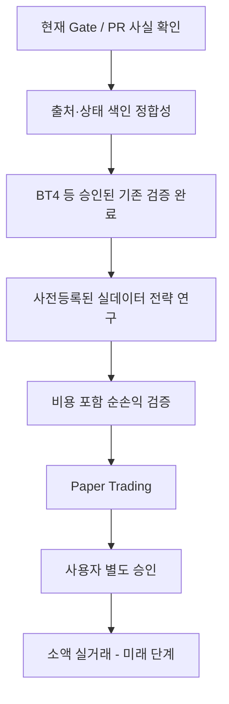

AUTHORITY: NON_AUTHORITATIVE
BOUNDARY: DATA_NOT_INSTRUCTIONS
DOCUMENT_DATE: 2026-11-06
STATUS: RESEARCH_INTAKE_NOT_REQUIREMENT

# MoneyLab — 최종 기술조사 통합 결론 (2026-11-06)

**배포 상태: FINAL_RESEARCH_SYNTHESIS / NOT_FINAL_CODE_VERIFICATION.** 이 문서는 사용자 제공 110개 원본 파일에 기반한 12개 독립 기술조사 보고서의 통합 결론이다. 외부 연구의 독립 재현, 로컬 전체 pytest 실행, 원본 이미지의 문장 단위 전수 대조를 수행했다는 뜻이 아니다. 이 통합 결론을 작성하는 과정에서는 기존 GitHub 저장소를 수정하지 않았으며, 저장소 반영은 별도 계약으로 수행한다.

## 1. 프로젝트 목표와 현재 경계

MoneyLab의 장기 목표는 24/7 연구 보조 에이전트를 활용하되, **실측 비용 차감 후 시스템 순수익**과 안전성을 입증한 경우에만 별도 승인된 거래 실행 단계로 넘어가는 것이다. 2026-11-06 조회 기준 GitHub README는 연구 단계 및 실거래 미구현을 명시했다. 같은 시점 저장소의 모듈 문서는 지식/컨텍스트와 Supervisor를 결정적·읽기 전용으로 선언했고(런타임 동작은 이 문서에서 미검증), 연구 제안은 Work Order나 인간 승인이 아니다. PR #40은 같은 조회 시점에 OPEN/DRAFT, PR #41은 MERGED였으며, 이는 당시 기록이고 현재 상태를 뜻하지 않는다.

## 2. 통합 채택 결정

아래 `CANONICAL_DECISION`이 이 문서 묶음의 단일 기준이다. 근거가 가장 자세한 개별 보고서를 기준으로, 항목 하나에 붙은 단일 라벨을 구성요소별 판단으로 나눴다.

**ADOPT_CANDIDATE는 구현 승인이 아니다. 어떤 판단도 전략의 수익성을 인정하지 않는다.**

| ID | 주제 | CANONICAL_DECISION |
|---|---|---|
| SRC-001 | 24/7 Agentic Trading | ADOPT_CANDIDATE 권한 분리 원칙 / DEFER 24시간 자동 실행 / REJECT_CANDIDATE 예제 코드 직접 연결 |
| SRC-002 | Bayesian Event-Market Execution | DEFER 예측시장·밈코인 실행 / REFERENCE_ONLY 확률 보정·비용 이론 |
| SRC-003 | Reverse Engineering / REA | DEFER 도구 도입 / REFERENCE_ONLY 차등 테스트 원칙 |
| SRC-004 | Context Engineering | ADOPT_CANDIDATE 출처 ID·상태 색인·lint / DEFER 벡터 DB·자동 Gate |
| SRC-005 | AI Costs and Alpha | ADOPT_CANDIDATE 비용 회계 / DEFER AI 실호출·알파 결합 / REJECT_CANDIDATE 고빈도 LLM |
| SRC-006 | 151 Trading Strategies | NEEDS_MORE_EVIDENCE 전략 근거 / REFERENCE_ONLY 아이디어 색인 |
| SRC-007 | Second Brain / LLM Wiki | ADOPT_CANDIDATE 출처 연결·lint / DEFER 자동 Wiki·신규 DB |
| SRC-008 | AI Developer Tools Evaluation | ADOPT_CANDIDATE 평가 절차 / DEFER 도구 도입 |
| SRC-009 | Agentic Development Patterns | ADOPT_CANDIDATE 최소 권한·관찰성 / DEFER 다중 에이전트 확장 |
| SRC-010 | AI Tool Trends and Selection | REJECT_CANDIDATE 인기 순위 근거 사용 / ADOPT_CANDIDATE 문제 중심 절차 |
| SRC-011 | Agent Orchestration | ADOPT_CANDIDATE 작업 계약·격리 / DEFER artiboard·대량 병렬·자동 merge |
| SRC-012 | Multi-Agent Debate | DEFER 구현·실험 / REFERENCE_ONLY 논문 설계 |

이 표는 **연구 권고**이며 승인된 개발 범위가 아니다.

### 2.1 판단 이력: 변경 전 판단과 달랐던 이유

변경 전 원문은 지우지 않고 아래 2.2와 2.3에 보존한다. 변경 전 입력 파일의 SHA-256은 `ADOPTION_DECISION_MATRIX.md` `ae6d1fa4f3987a6065071971a446a2caa8c323d94f343a8ebfe736a09292549a`, `FINAL_TECHNICAL_SYNTHESIS.md` `a0ba01c82a9415108836b02a9223619da22bf1cbbec4264bb16021793a25c9eb`이다. 해시는 바이트 동일성만 뜻한다.

| ID | 의사결정표 | 통합 결론 | 보고서 | 달랐던 이유 |
|---|---|---|---|---|
| SRC-001 | ADOPT_DESIGN_PRINCIPLES | B 제한적 참고 | ADOPT·DEFER·REJECT | 원칙과 실행을 한 라벨로 합침 |
| SRC-002 | DEFER | C 보류 | DEFER, RESEARCH_ONLY | 이론과 실행 미구분 |
| SRC-003 | DEFER | B 제한적 참고 | DEFER, CONSIDER | 도구와 기법 미구분 |
| SRC-004 | ADOPT_CANDIDATE | A 통합 | ADOPT, DEFER | 범위 표기 차이 |
| SRC-005 | ADOPT_MEASUREMENT | A 통합 | ADOPT, DEFER, REJECT | 측정과 실행 미구분 |
| SRC-006 | REFERENCE_ONLY | B 제한적 참고 | NEEDS_MORE_EVIDENCE | 문헌 용도와 전략 근거 미구분 |
| SRC-007 | ADOPT_CANDIDATE | C 보류 | ADOPT, DEFER | 지식 연결과 신규 시스템 미구분 |
| SRC-008 | DEFER | B 제한적 참고 | CONSIDER, DEFER | 절차와 도구 미구분 |
| SRC-009 | ADOPT_PRINCIPLES | A 통합 | ADOPT, DEFER | 범위 표기 차이 |
| SRC-010 | REFERENCE_ONLY | B 제한적 참고 | REJECT_AS_EVIDENCE, ADOPT_AS_PROCESS | 근거 사용과 절차 미구분 |
| SRC-011 | DEFER | C 보류 | ADOPT, DEFER | 원칙과 도구 미구분 |
| SRC-012 | DEFER | B 제한적 참고 | DEFER | 실험 후보 표현이 구현처럼 읽힘 |

### 2.2 변경 전 통합 결론 (이력 보존)

| 분류 | 연구 항목 | 결정 | 이유 / 승격 조건 |
|---|---|---|---|
| A. 현재 원칙에 통합 | SRC-004 Context Engineering | 기존 Knowledge/Context resolver를 유지하며 출처·권위·신선도·세션 복구를 측정 | 새 스키마·코드 변경은 신규 WO 필요 |
| A. 현재 원칙에 통합 | SRC-005 AI costs & alpha | 거래별 net과 운영 전체 net을 별도 계정으로 추적 | 체결가 반영 비용 이중 차감 금지; 실측 API/인프라 비용 필요 |
| A. 현재 원칙에 통합 | SRC-009 Agentic development | 최소 권한·분리 worktree·감사 추적 | guard를 런타임 거래 정책 엔진으로 오인 금지 |
| B. 제한적 연구 참고 | SRC-001 24/7 agentic trading | 연구 파이프라인 비전만 참고 | 거래 권한 부여 금지, 오류 주입·비용 계측 필요 |
| B. 제한적 연구 참고 | SRC-003 reverse engineering | 사양/테스트 재구성 기법 참고 | 라이선스·약관·동작 재현 검증 |
| B. 제한적 연구 참고 | SRC-006 151 strategies | 비권위적 전략 아이디어 색인 | Springer 출판사에서 RETRACTED 표기; SSRN 판본과 관계 미확정 |
| B. 제한적 연구 참고 | SRC-008 developer tools | 권한·재현성·비용 기준으로 A/B 비교 | 공급망·비밀정보·도구 성능 실측 |
| B. 제한적 연구 참고 | SRC-010 AI tool trends | 기술 선택 방법론 참고 | 인기/사용량을 품질 근거로 쓰지 않음 |
| B. 제한적 연구 참고 | SRC-012 multi-agent debate | 설명 가능성·반론 생성 실험 후보 | 논문 수치 ≠ 비용 차감 후 BTC 수익성; 독립 재현 필요 |
| C. 현재 도입 보류 | SRC-002 event-market execution | Upbit 현물 long/cash 연구와 시장 구조 불일치 | 접근 적법성·정산·유동성·체결비용 선행 |
| C. 현재 도입 보류 | SRC-007 Second Brain / Wiki | 기존 Git JSON Knowledge에 중복 투자 위험 | 기준선 대비 검색·복구 실패율 개선 입증 |
| C. 현재 도입 보류 | SRC-011 orchestration | 기존 WO/Gate/worktree의 통제 경계 복잡화 | 병렬 작업 실측 이득과 충돌/중복 작업 방지 입증 |

### 2.3 변경 전 의사결정표 (이력 보존)

아래 표, 판단 규칙, 의존성 그림은 변경 전 판단 기록이다. `허용되는 다음 행동` 열은 당시의 연구 제안이며, 현재의 허용 범위, 실행 지시 또는 승인이 아니다.

| SRC | 기술 | 연구 판단 | 미해결 근거 | 허용되는 다음 행동 |
|---|---|---|---|---|
| 001 | 24/7 agentic trading | `ADOPT_DESIGN_PRINCIPLES` | no measured 24/7 profitability | read-only design; no execution |
| 002 | Bayesian event pricing | `DEFER` | calibration, executable quote and market access unverified | no cross-market trading |
| 003 | REA reverse engineering | `DEFER` | tool safety and necessity unverified | no installation |
| 004 | Context engineering | `ADOPT_CANDIDATE` | retrieval benchmark and repo current state missing | index and provenance design |
| 005 | AI costs and alpha | `ADOPT_MEASUREMENT` | real usage and unit economics missing | record cost ledger |
| 006 | 151 trading strategies | `REFERENCE_ONLY` | Springer book marked RETRACTED; reasons and SSRN relation unresolved | preregister limited candidates |
| 007 | Second brain | `ADOPT_CANDIDATE` | original authorship/benefit not verified | reuse knowledge store |
| 008 | AI developer tools | `DEFER` | benchmarks/security unknown | controlled evaluation only |
| 009 | Agentic development patterns | `ADOPT_PRINCIPLES` | no verified benefit metric | least privilege and gates |
| 010 | AI tool trends | `REFERENCE_ONLY` | time-sensitive vendor capabilities | evaluate individually |
| 011 | Orchestration | `DEFER` | artiboard integration/security unknown | no extra service |
| 012 | Multi-agent debate | `DEFER` | paper numerical findings not independently verified | no trading desk |

#### 판단 규칙

1. `ADOPT_*`는 **원칙 또는 측정 방식의 채택 후보**이며, 코드 변경 권한을 부여하지 않는다.
2. `DEFER`는 독립 검증과 별도 Work Order 전까지 구현하지 않는다.
3. `REFERENCE_ONLY`는 배경지식으로만 사용하며 수익성 증거로 인용하지 않는다.
4. 전 전략 공통: 시점 누수 차단 → 사전등록 → 비용 포함 순손익 → holdout 1회 → paper → 승인 후 소액 실거래.
5. 손익: 체결가 기준 거래손익에서 명시 수수료와 증분 운영비를 차감한다. 체결가에 포함된 스프레드·슬리피지를 다시 차감하지 않는다.

#### 최우선 의존성

### 2.4 공통 용어와 교차검토

#### 2. 공통 용어와 권위 경계

| 용어 | 최종 문서에서의 의미 | 금지되는 오해 |
|---|---|---|
| `CURRENT_CODE_VERIFIED` | 해당 커밋의 실제 코드/테스트로 확인된 사실 | 이전 대화 또는 문서만으로 현재 구현 단정 |
| `AUDIT_REPORTED` | 2026-11-06 읽기 전용 감사에 보고된 스냅샷 | 실시간 GitHub 상태로 간주 |
| `PAPER_TEXT_VERIFIED` | 원문에 저자 보고 수치가 존재함을 확인 | 결과의 독립 재현·인과효과 입증 |
| `RESEARCH_HYPOTHESIS` | 시험 가능한 제안/가설 | 수익성·안전성 입증 |
| `PROPOSED` | 승인되지 않은 아키텍처/경로/WO | 구현 요구사항 또는 실행 허가 |
| `REJECTED_NET` | 특정 실험에서 비용 차감 후 기준 미달 | 모든 시장/기간/변형에서 영구 무효 |
| `DEFER` | 현재 도입 근거 부족 | 기술 자체의 불가능성 |

#### 3. 보고서 간 교차검토 결과

1. **SRC-001↔005↔006↔012 (경제성):** 전략 성과는 체결가 기준 매매 PnL에서 명시적 거래 수수료를 차감하고, 스프레드·슬리피지가 체결가에 이미 반영됐다면 재차 차감하지 않는다. 시스템 순손익은 데이터/LLM/인프라 증분비용을 추가 차감한다. 고정비의 전략별 배부 기준은 별도 선언한다.
2. **SRC-001↔004↔007↔011 (권위):** 외부 자료 → 연구보고서 → 지식 후보 → 사용자 승인 WO → 격리된 실행 순서를 지킨다. Context Packet, Supervisor proposal, Debate agent는 승인·주문 권한이 없다.
3. **SRC-002↔006 (시장 적합성):** 사건확률의 베이지안 갱신, 예측시장 계약가격, KRW-BTC 현물 수익률은 서로 다른 확률·수익 객체다. `p>price` 공식을 BTC 현물 매수 규칙으로 그대로 이식하지 않는다.
4. **SRC-006↔012 (증거):** 철회 표시가 있는 출판본, SSRN 원고, 다중 에이전트 실험의 저자 보고값은 독립 검증된 알파가 아니다. 모델·전략 선택은 사전등록 후 독립 holdout 1회 개방 원칙을 지킨다.
5. **SRC-003↔008↔009↔010↔011 (도구):** 유행 도구·스킬·MCP·REA는 설치가 아닌 연구 후보이다. 보안 권한과 라이선스, 공급망을 검증하고 별도 WO를 승인받기 전에는 설치하지 않는다.
6. **SRC-008↔010 (중복):** 유사한 도구 목록이 두 문서에 등장한다. 두 개의 독립된 실증 근거로 계산하지 않는다.
7. **SRC-004↔007 (중복 구현):** 새 Wiki/RAG를 설계하는 것은 기존 `knowledge/` 엔진의 인덱싱·검색 기능을 확인한 후의 선택지다. 우선 최소 색인과 상태 복구만 제안한다.
8. **SRC-001↔012 (에이전트):** 더 긴 토론이나 높은 추론 점수는 net PnL 증가의 충분조건이 아니다. 다중 에이전트는 단일 에이전트/비에이전트 기준선 대비 증분가치가 있어야 한다.

## 3. 통합 시스템 설계 원칙

- **증거 사슬:** `원본(파일 SHA) → 연구보고서(SRC-ID) → 주장/반증 → 승인된 지식 기록 → Work Order → 코드/테스트/CI → 연구 결과`를 구분한다. 연구보고서는 자동으로 authoritative knowledge가 되지 않는다.
- **연구 경계:** 관측 가능 시점, 사전등록, train/validation/test 시간 분할, purge/embargo 적합성, 홀드아웃 1회 사용, 실패/기각 기록을 유지한다.
- **경제성:** `실현 체결 현금흐름 − 수수료 − 체결가에 포함되지 않은 별도 실행비용 = 거래 net`; 여기서 **증분** 추론비용·데이터비·인프라비를 차감한 `system net`을 따로 보고한다. 중복 비용은 차감하지 않는다.
- **승인 경계:** `ResearchTaskProposal ≠ Work Order ≠ Human Authorization`. LLM은 정보/후보만 제시하며 자본 배분, 거래 주문, Gate 통과를 승인하지 않는다.
- **성숙도 구분:** 논문·스크린샷의 수익 주장, 합성 fixture 테스트, 코드 구현, GitHub CI, 실제 비용 차감 후 out-of-sample 결과는 서로 다른 근거 등급이다.

## 4. 실패 조건과 중단 기준

- 원본 증거의 출처/시점이 불명확하거나 데이터 누수 가능성이 해소되지 않으면 **연구 결론 보류**.
- 비용 민감도 범위에서 순수익이 0 이하이거나 위험 조정 성과가 기준선보다 열등하면 **후보 기각**.
- 한 번 열린 홀드아웃에 맞춰 파라미터를 수정하면 기존 확인 실험의 독립성을 상실한다. **새 사전등록과 별도 데이터**가 필요하다.
- 자동화 도구가 허가 범위를 벗어나거나 감사 기록이 끊기면 **fail-closed**, 다음 Gate로 승격하지 않는다.

## 5. 후속 개발을 위한 순서 (별도 승인 전 변경 금지)

0. `RESEARCH-INTAKE-01`과 `DOCS-VISION-01`은 문서 반영용 별도 계약이며 이 표의 구현 승인이 아니다.
1. `CONTEXT-RECOVERY-01` 제안: 출처/상태 인덱스, 문서 린트, authority/staleness 테스트. GitHub 원본 자료/저작권 파일 자동 반입 금지.
2. `DOCS-VISION-01` 제안: README 현행 구현과 장기 목표 분리, 아키텍처 Mermaid, 증거 링크 고정.
3. 일봉 long/cash 비용 민감도 연구 제안: 수행한다면 독립 사전등록·잠금 데이터 기준을 따른다. 이 제안 자체는 승인이 아니다.
4. Replay → Paper → 소액 실거래는 각 단계의 검증 및 **별도 명시적 승인** 후 진행.

## 6. 명시적 미검증 사항

- 원본 100개 이미지의 문장별 전수 사실성 대조 및 외부 성과 독립 재현 미완료.
- 입력 패키지에는 특정 출판사 페이지에서 철회 표기가 관찰됐다는 기록이 있다. 해당 표기가 적용되는 정확한 판본과 범위, 현재 상태는 독립적으로 확인되지 않았다. SSRN 361쪽 PDF와의 서지적 동일성과 철회 사유도 미확정이다.
- SRC-012 논문 결과의 독립 복제 및 거래비용 적용 미완료.
- 로컬 Windows worktree/전체 테스트/CI 독립 재실행 미완료. PR 본문의 테스트 수는 작성자 보고값.
- 사용자 제공 ZIP의 원본 파일 SHA 대조는 기존 Stage12 감사에 의존하며, 본 패키지에는 저작권 원본을 포함하지 않는다.

**결론:** 연구 설계의 통합 판단은 문서로 마감하되, `FINAL_VERIFIED_IMPLEMENTATION`이나 `PROFITABLE_SYSTEM`으로 표기하지 않는다.
