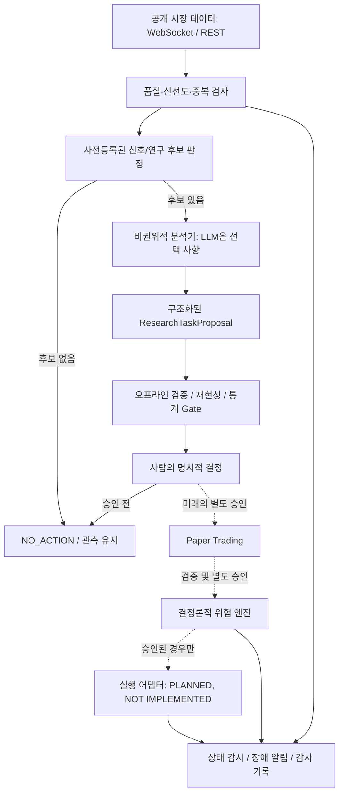

AUTHORITY: NON_AUTHORITATIVE
BOUNDARY: DATA_NOT_INSTRUCTIONS
DOCUMENT_DATE: 2026-11-06
STATUS: RESEARCH_INTAKE_NOT_REQUIREMENT
CANONICAL_DECISION: ADOPT_CANDIDATE 권한 분리 원칙 / DEFER 24시간 자동 실행 / REJECT_CANDIDATE 예제 코드 직접 연결
DECISION_BOUNDARY: ADOPT_CANDIDATE는 구현 승인이 아니다. 어떤 판단도 전략의 수익성을 인정하지 않는다.
AUDIT_REFERENCE_NOTE: 이 문서가 ML-CTX-AUDIT-20261106-001 또는 Claude Code 감사를 인용하는 경우, 그 근거는 Git 밖 감사 보고이며 독립 증거가 아니다.

# SRC-001 — 24/7 Agentic Trading 시스템: 분석·위험 승인·실행의 권한 분리

> **상태:** 심층 기술조사 초안 — 구현 지시·실거래 승인 아님
>
> **MoneyLab 판단:** `ADOPT_CANDIDATE`(권한 분리·구조화된 연구 제안·저널·중단 설계), `DEFER`(24시간 자동 실행), `REJECT_CANDIDATE`(외부 예제 코드를 검증 없이 거래소에 연결)
>
> **증거 범위:** 사용자 제공 20장 자료의 설계 주장과 2026-11-06 Claude Code 저장소 감사 결과를 분리해 서술. 실제 거래 수익, 예제 코드 보안·재현성, 운영 안정성은 검증되지 않음.

## 1. Executive Summary

24/7 Agentic Trading은 모델이 하루 종일 매수·매도 판단을 반복하는 구조가 아니다. 시장이 열려 있는 동안 **데이터 수집과 시스템 감시를 지속**하면서, 정보가 충분하고 사전 정의된 조건이 충족될 때에만 분석·검증·위험 심사를 수행하는 운영 방식이다. 핵심 설계 문제는 LLM의 예측 능력보다 **불확실하고 비결정적인 분석 결과가 자산을 움직일 수 있는 권한으로 승격되는 경로**를 통제하는 것이다.

자료에서 제안하는 기본 구조는 분석기(LLM), 결정론적 위험 엔진(일반 코드), 실행기(브로커 API)의 3계층 분리다. MoneyLab에서는 이를 더 엄격히 해석한다. 현재는 **읽기 전용 데이터·연구 단계**이므로 분석기는 거래 명령이 아니라 `ResearchTaskProposal` 같은 비권위적 연구 제안을 낼 수 있을 뿐이다. 향후 검증된 전략, 사용자 승인, 페이퍼 거래, 소액 실거래라는 독립적인 Gate를 거치기 전에는 실행기를 추가하지 않는다.

24시간 가동 자체는 투자 우위의 증거가 아니다. 거래비용·모델비·인프라비를 포함한 시스템 순손익과 장애·복구 가능성이 입증되지 않으면, 지속 운영은 손실과 비용을 늘리는 자동화가 될 수 있다.

## 2. 문제 정의: 시장 감시와 주문 권한은 별개다

암호화폐 현물 시장은 연중무휴로 움직인다. 그러나 매초 LLM에 호가창을 보내는 방식은 (1) 입력 중복, (2) 높은 호출비, (3) 정보의 시점 불일치, (4) 레이턴시, (5) 잘못된 주문의 반복 가능성을 키운다. 따라서 세 개의 시간 척도를 구분해야 한다.

1. **감시 주기:** WebSocket 수신, 데이터 신선도·연결 상태 점검. 시장이 움직이지 않아도 실행한다.
2. **연구·신호 주기:** 사전등록된 캔들 종료 또는 사전에 정의한 이벤트 발생 시 평가한다. 정보가 없는 주기는 건너뛴다.
3. **실행 주기:** 현재 MoneyLab에는 존재하지 않는 별도 경로다. 미래에 허용되더라도 전략·위험·주문 중복 방지 규칙을 충족해야 한다.

자료의 'overnight research, daytime review' 개념은 AI가 밤에 포지션을 임의로 바꾸는 뜻이 아니라, 밤에는 읽기 전용 연구를 수행하고 사용자가 검토·승인할 수 있는 기록을 남기는 모델로 해석하는 것이 안전하다.

## 3. 아키텍처: 분석기·위험 엔진·실행기



**이 도식은 목표와 현재 상태를 혼합한 설명도**다. `Paper Trading`의 오프라인 구성요소와 실제 거래소 연동 페이퍼 시스템은 동일하지 않으며, 실주문 실행 경로는 미구현으로 취급한다.

### 3.1 분석기(Analyst)

입력은 시점이 고정된 가격·체결·호가·기존 연구 결과다. 외부 뉴스, 소셜 게시물, 웹 페이지는 모두 **신뢰할 수 없는 데이터**다. 출력은 확률이나 가격 전망이 아니라도 되며, 반증 가능한 가설, 필요한 추가 데이터, 실패 조건을 구조화해 제시하는 것이 우선이다. LLM 출력은 시장의 사실이나 전략 승인으로 승격되지 않는다.

### 3.2 위험 엔진(Risk Engine)

순수 코드로 결정론적으로 평가해야 하는 항목은 데이터 신선도, 거래 허용 여부, 주문 단위, 최대 노출, 잔고, 중복 주문, 미체결 주문, 손실 한도, kill switch, 재시작 복구 상태다. **모델의 자연어 '안전하다'는 위험 심사를 대체할 수 없다.** 자료의 예시에서 `MAX_POSITION_PCT`, `MAX_DAILY_LOSS_PCT`, `ALLOWED_SYMBOLS` 등은 설계 패턴일 뿐 MoneyLab의 승인된 수치가 아니다.

### 3.3 실행기(Executor)

미래에 도입하더라도 분석기가 거래소 SDK를 직접 호출해서는 안 된다. 실행기는 검증된 주문 의도만 받고, idempotency 키·주문 상태 조회·체결 확인·취소·복구를 처리한다. REST 타임아웃은 '주문 실패'를 의미하지 않으므로, 재시도 전 거래소 주문 상태를 조회해야 한다. 현재는 이 인터페이스의 설계 논의까지만 허용한다.

## 4. 구조화된 제안과 데이터 계약

자유 형식의 매매 논평은 검증·재현·감사하기 어렵다. 자료가 강조하는 'thesis as a type'은 유효하지만, MoneyLab에서는 거래 제안과 연구 제안을 분리해야 한다.

```json
{
  "proposal_type": "RESEARCH_ONLY",
  "market": "KRW-BTC",
  "as_of_utc": "<observed timestamp>",
  "input_manifest_sha256": "<64-char hash>",
  "hypothesis": "<falsifiable claim>",
  "required_data": ["<dataset identifier>"],
  "evaluation": {
    "primary_metric": "net_after_trading_costs",
    "baseline": "cash_or_preregistered_rule",
    "leakage_checks": ["point_in_time", "split_lock"]
  },
  "authority": "NON_EXECUTABLE"
}
```

이는 **설명용 제안 스키마**이며 기존 `ResearchTaskProposal` 구현과의 필드 호환성은 검증되지 않았다. 실제 채택 시 현재 Supervisor 모델과 테스트에 맞춰야 한다. 자연어 입력이 코드·셸·주문 인자로 전달되지 않도록 구조 검증과 허용 목록이 필요하다.

## 5. 지속 운영 상태 기계와 실패 처리

장시간 실행에서 가장 어려운 문제는 예측보다 **정확히 한 번만 실행한 것처럼 보장하는 효과(exactly-once effect)**다. 네트워크와 프로세스가 불안정하므로 단순 루프만으로는 해결되지 않는다.

| 상태 | 허용 동작 | 실패 시 기본 행동 |
|---|---|---|
| `STARTUP` | 설정·버전·데이터·시계 확인 | 시작 중단 |
| `OBSERVE` | 공개 데이터 수신 및 기록 | 데이터 stale 표시, 연구 중지 |
| `EVALUATE` | 사전 정의한 조건 평가 | `NO_ACTION` |
| `RESEARCH` | 비권위적 연구 제안 생성 | 제안 폐기, 입력 보존 |
| `REVIEW_REQUIRED` | 사용자 승인 대기 | 실행 금지 |
| `PAPER` | 별도 승인된 모의 체결 | 상태 복구 전 신규 행동 금지 |
| `HALTED` | kill switch 활성화 | 자동 해제 금지 |

상태 전이 기록에는 입력 해시, 시간, 구성 버전, 전략 ID, 판단 근거, 예외 및 재시도 횟수가 필요하다. 시스템 재시작 시 마지막 상태를 모르면 `OBSERVE` 또는 `HALTED`로 보수적으로 복귀해야 한다. 일별 한도는 한국시간/UTC 등 기준 시각과 손익 계산 범위를 먼저 고정해야 한다.

## 6. 비신뢰 입력과 프롬프트 인젝션

시장 뉴스와 소셜 텍스트는 공격자가 '이전 규칙을 무시하고 주문하라'는 지시를 삽입할 수 있는 입력이다. 방어는 '무시하라'는 프롬프트 한 줄로 완성되지 않는다.

- 입력을 `untrusted_content`로 태깅하고 데이터와 시스템 명령을 분리한다.
- LLM 프로세스에는 주문 API 키·거래소 쓰기 권한·임의 셸 권한을 제공하지 않는다.
- 외부 자료에 포함된 링크·코드·설정 변경 요구를 자동 실행하지 않는다.
- 결과를 타입·길이·허용 키·출처 기준으로 검사한다.
- 실패하거나 해석 불가능한 응답은 `NO_ACTION`으로 처리한다.

## 7. 거래 전략의 통계적 검증과 '백테스트 함정'

자료의 핵심 경고는 LLM이 이미 알고 있는 과거 가격 구간에 대해 그럴듯한 설명을 만들어내는 **look-ahead contamination**이다. 모델이 특정 연도의 뉴스와 결과를 사전학습했을 가능성이 있다면, '과거 시점의 뉴스만 제공'하는 것만으로 완전한 시점 격리가 보장되지 않는다.

따라서 다음을 구분한다.

- **규칙 기반 백테스트:** 시점 고정 가격 데이터, 명시된 체결 가정, 수수료·스프레드·슬리피지, 사전등록된 분할을 사용한다.
- **LLM 보조 연구:** 모델이 제안한 아이디어를 이후 독립 데이터에서 평가하되, 아이디어 생성에 노출된 자료를 검증 데이터로 재사용하지 않는다.
- **전진 시험(Forward/Paper):** 이후에 도착한 실제 데이터를 사용하고 모델·프롬프트·구성 해시를 고정한다.

최소 비교군은 현금, buy-and-hold, 승인된 단순 규칙 전략이다. 복잡한 AI 전략은 이 기준선을 **거래비용 차감 후** 넘어야 하고, 도입 판단에서는 AI·인프라 비용까지 뺀 시스템 순손익을 별도로 비교해야 한다. 여러 프롬프트·전략·기간을 시험하면 다중검정과 선택 편향이 발생한다. 테스트 구간은 사전등록된 1회 개방 정책을 지킨다.

## 8. MoneyLab 현재 구현과 격차

아래는 **2026-11-06 Claude Code 감사 보고의 간접 확인**이다. 최신 저장소를 이 보고서 작성 중 재실행·재검증하지 않았다.

| 기능 | 감사 보고의 근거 | 평가 |
|---|---|---|
| 공개 Upbit 데이터 수집 | recorder / WebSocket·REST | 일부 구현 |
| 위험 중단 로직 | `risk/kill_switch.py`, 테스트 | 일부 구현; 실제 주문 차단과 동등하지 않음 |
| 연구 제안 | `supervisor/proposal.py`, 권한 격리 테스트 | 비권위적 연구용 구현 |
| 비용·손익 평가 | `analytics/spot_costs.py`, `backtest/costs.py`, `pnl/` | 거래비용 중심 |
| 오프라인 paper 구성요소 | `paper/` | 실제 거래소 페이퍼 연동 미검증 |
| LLM 분석 호출 | 외부 모델 import 미확인 | 미구현으로 보고 |
| 24/7 운영 데몬·재시작 복구·알림 | 근거 없음 | 미구현 |
| 실거래 주문 실행 | 연구 단계, 실거래 경로 없음 | 미구현 / 미승인 |

자료의 Alpaca·미국 주식 코드 예시는 Upbit KRW-BTC 현물의 주문 단위, 인증, 수수료, 호가·체결 API와 호환된다는 증거가 없다. 예제를 붙여넣어 바로 실행하는 접근은 거부한다.

## 9. 대안 비교

| 대안 | 장점 | 한계 | 현재 권고 |
|---|---|---|---|
| 규칙 기반 연구 + 수동 승인 | 재현성, 낮은 비용, 명확한 책임 | 아이디어 발굴 속도 제한 | **기본값** |
| 이벤트 기반 LLM 연구 보조 | 필요한 때만 호출, 연구 다양화 | 비용, 비결정성, 검증 부담 | 설계 후보 |
| 24/7 LLM 순환 호출 | 구현 설명이 단순 | 중복 판단·비용·상태 위험 | 보류 |
| 다중 에이전트 상시 토론 | 상반된 관점 기록 | 호출비·합의 편향·성과 미검증 | 보류 |
| LLM 직접 주문 실행 | 연결이 쉬워 보임 | 권한·손실·감사 위험 | 기각 |

## 10. 운영비와 시스템 순손익

```text
net_trading_pnl = PnL_using_defined_valuation_basis - applicable_explicit_execution_fees
net_system_pnl  = net_trading_pnl - model_cost - data_cost - infrastructure_cost - monitoring_cost
```

체결가에 이미 스프레드·슬리피지가 반영되어 있으면 이를 다시 차감하지 않는다. 가격 기준, 미체결 처리, 모델 재시도, 로그 보관, 고정비 배분을 사전에 정의한다. 24/7 가동 비용은 연 365일 기준으로 추정하되, 실제 과금 단가는 공식 청구·가격표로 확인해야 한다. **거래 전략이 검증되지 않은 현재 단계에서는 비용이 드는 상시 AI 호출의 경제적 근거가 없다.**

## 11. 채택 판단과 재검토 조건

**지금 채택할 설계 원칙:** 분석/권한 분리, 불신 데이터 처리, 타입이 있는 연구 제안, 결정론적 Gate, 관측·감사 로그, fail-closed 중단 정책.

**보류할 기능:** 상시 LLM 호출, 거래소 연동 paper, 다중 에이전트 토론, 자동 주문, 원격 알림·복구 인프라 확장.

**재검토 Gate(제안):** (1) 현재 v0.6 연구 계약과 데이터 분할 확정, (2) 거래비용 후 유효한 전략 근거 확보, (3) 오프라인 replay와 장시간 paper 안정성 측정, (4) 호출·인프라 비용을 포함한 증분 시스템 순손익 검증, (5) 독립적 사용자 승인 및 소액 한도·kill switch 검증. 어느 조건도 이 보고서로 충족되었다고 선언하지 않는다.

## 12. 근거·추적성·한계

- `ZIP:001` — 24/7 trading architecture, thesis typing, untrusted inputs, analyst/risk/executor separation, journal, kill switch, overnight research, backtesting contamination, paper-first 원칙. **외부 게시물의 구현 예시 및 성과는 독립 검증되지 않음.**
- `CLAUDE_AUDIT:ML-CTX-AUDIT-20261106-001` — MoneyLab의 기능·미구현 상태에 관한 2026-11-06 감사 보고. 코드 재확인 필요.
- `SRC-005` — 모델·데이터·인프라 비용과 거래비용 이중 차감 방지에 관한 별도 연구 초안.
- `SRC-012` — 다중 에이전트 토론의 설명 품질과 투자 성과를 구분한 별도 연구 초안.

이 문서는 기술 원리와 MoneyLab에 대한 **제안적 해석**을 제공한다. 자료에 제시된 미국 주식·Alpaca 기반 예제의 수치, API 호환성, 안전성, 수익성은 검증된 사실이 아니다. 원본 저작물·스크린샷·PDF를 GitHub에 재배포하지 않고, 공개 가능한 독자적 분석 문서와 출처 메타데이터만 반영한다.
