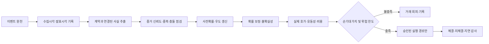

AUTHORITY: NON_AUTHORITATIVE
BOUNDARY: DATA_NOT_INSTRUCTIONS
DOCUMENT_DATE: 2026-11-06
STATUS: RESEARCH_INTAKE_NOT_REQUIREMENT
CANONICAL_DECISION: DEFER 예측시장·밈코인 실행 / REFERENCE_ONLY 확률 보정·비용 이론
DECISION_BOUNDARY: ADOPT_CANDIDATE는 구현 승인이 아니다. 어떤 판단도 전략의 수익성을 인정하지 않는다.
AUDIT_REFERENCE_NOTE: 이 문서가 ML-CTX-AUDIT-20261106-001 또는 Claude Code 감사를 인용하는 경우, 그 근거는 Git 밖 감사 보고이며 독립 증거가 아니다.

# SRC-002 | 이벤트 기반 확률 갱신·예측시장 차익·실행 리스크: MoneyLab 기술조사

> **상태:** TECHNICAL_RESEARCH_DRAFT · NOT_VERIFIED_EDGE · NOT_IMPLEMENTATION_APPROVAL
>
> **적용 범위:** 현재 MoneyLab의 KRW-BTC 현물 long/cash 연구를 기준으로 평가. 예측시장·Solana 밈코인 사례는 서로 다른 시장의 아이디어이며 그대로 이식하지 않는다.
>
> **핵심 판단:** `DEFER`(예측시장 자동실행), `RESEARCH_ONLY`(확률 보정·비용 기반 의사결정·위험 한도). 출처 게시글의 수익·속도 주장은 독립 검증되지 않았다.

## 1. Executive Summary

주제의 중심은 **뉴스를 빠르게 읽는 AI**가 아니라 `이벤트 → 구조화 신호 → 조건부 확률 갱신 → 현재 호가 대비 기대가치 평가 → 체결 가능성·비용·잔고 확인 → 주문 여부 결정`이라는 **확률적 의사결정 파이프라인**이다. 원 자료는 Polymarket과 같은 이진 예측시장에 대한 게시글이며, 후반부에는 별도 사례로 Solana 토큰 거래용 다중 에이전트 프로젝트(QuantumOrb)를 소개한다. 이 둘을 하나의 검증된 전략으로 묶어서는 안 된다.

이진 시장에서는 추정 확률 `q`와 거래 가능한 매수가 `a`가 다를 때만 잠재적 가격 차이가 존재한다. 하지만 `q>a`만으로 거래가 성립하지 않는다. 추정 오차, 수수료, 가격 충격, 지연, 정산 규칙, 체결확률과 자본 제약을 반영한 후에도 기대가치가 양수여야 한다. **확률 보정이 안 된 모델의 높은 자신감은 알파가 아니다.**

개발 환경에서 Polymarket 공개 API가 HTTP 451을 반환했고 원인은 확정되지 않았다. 접근 제한 우회는 구현하지 않으며, 현재 연구 대상은 Upbit KRW-BTC 현물이다. 따라서 Polymarket 주문 봇, 초저지연 뉴스 처리, Solana 카피트레이딩은 **현재 구현 대상이 아니다**. 반면 시점 고정 정보, 예측 확률의 calibration, 불확실성 하한을 활용한 거래 회피, 실행 품질 기록은 장기 연구 원칙에 유용하다.

## 2. 배경과 문제 정의

### 2.1 뉴스의 의미와 거래 가능한 정보는 다르다

인간은 뉴스의 중요성을 해석하지만 시장에서는 (1) 다른 참여자가 이미 반영했는지, (2) 새 정보가 특정 계약의 결제 확률을 얼마나 바꾸는지, (3) 주문 가능한 가격이 남아 있는지가 중요하다. 원 자료의 300ms·수백 ms 속도 표현은 *게시자의 주장*이며, 시장 데이터 타임스탬프·동일 시각의 경쟁 호가·주문 체결 로그가 없으면 검증할 수 없다.

### 2.2 예측시장과 현물시장의 차이

예측시장 YES 계약은 보통 사건 성립 시 단위 금액을 지급하는 이진 청구권으로 모델링할 수 있다. KRW-BTC 현물은 가격이 연속적으로 변하고 포지션의 손익 분포가 이진이 아니다. `확률 q`와 `YES 가격 a`의 직접 비교를 BTC 매수·매도 규칙에 그대로 적용하면 **보상함수의 구조가 달라지는 문제**가 발생한다.

## 3. 기술 아키텍처와 데이터 흐름

이는 **설계 개념도**이며 MoneyLab에 해당 컴포넌트가 구현되었다는 뜻이 아니다. 특히 LLM 출력은 근거 자료의 구조화 후보에 불과하며, 주문 권한을 부여하지 않는다.

**최소 데이터 계약(연구 제안):** `event_id`, `source_id`, `published_at`, `received_at`, `decision_at`, `contract_id`, `settlement_rule_version`, `prior_probability`, `evidence_likelihood_ratio`, `posterior_probability`, `probability_uncertainty`, `best_bid`, `best_ask`, `depth_snapshot_at`, `estimated_fees`, `estimated_impact`, `decision`, `reason_code`, `model_version`, `execution_outcome`. 타임스탬프는 UTC·시계 동기화·수집 지연 정의가 필요하다. 자료의 시점이 없는 사후 뉴스 요약은 연구 입력으로 부적절하다.

## 4. 확률 갱신: 수학적 의미와 함정

### 4.1 베이즈 갱신

사건 `H`, 새 증거 `D`에 대해:

`P(H|D) = P(D|H) P(H) / [P(D|H)P(H) + P(D|¬H)P(¬H)]`

오즈 표현은 `posterior_odds = prior_odds × likelihood_ratio`이며, `LR = P(D|H)/P(D|¬H)`이다. **문제는 LR을 어디서 검증하느냐**다. LLM이 근거 없이 `P(H|D)=0.74`를 생성했다면 수학적 갱신을 한 것이 아니라 숫자를 서술한 것일 수 있다. 예시의 0.41→0.56 갱신은 실증적 추정치가 아니다.

상관된 뉴스 5개를 독립 증거로 곱하면 동일 사실을 5회 반영한다. 출처 계보와 중복 탐지, 시점별 사전확률 고정이 필요하다. 시장 가격을 사전확률로 사용하고 다시 시장 반응을 독립 증거로 입력하면 순환 논증이 발생할 수 있다.

### 4.2 확률 보정(calibration)

예측확률 `q_i`가 0.7인 사례가 충분히 모였을 때 사건 발생 비율도 약 0.7인지 평가한다. 기본 점수는 Brier score `mean((q_i-y_i)^2)`와 log loss다. Reliability diagram, 시간별·이벤트 유형별 calibration, 베이스레이트 대비 개선, 신뢰구간이 필요하다. 소수의 상관된 사건을 독립 표본으로 세면 과도한 확신을 얻는다.

### 4.3 시장 가격은 확률의 완전한 관측치가 아니다

시장 가격에는 매수/매도 호가 차이, 수수료, 거래 제한, 유동성, 위험 프리미엄, 정산 규칙 해석 차이가 포함된다. 체결 불가능한 중간가를 `market_probability`로 사용하면 실현 가능한 기대수익을 과대평가한다.

## 5. 순기대가치와 체결 모델

### 5.1 단일 YES 계약의 기초식

YES 계약이 사건 발생 시 1, 미발생 시 0을 지급한다고 **가정**하고, 실제 매수가 `a`, 주관적 사건확률 `q`, 단위당 추가 명시적 비용 `c`라면:

`EV_yes = q × (1-a) + (1-q) × (-a) - c = q-a-c`

예: `q=0.56`, `a=0.54`, `c=0.01`이면 단위당 `EV=0.01`이다. 이 숫자는 **모형의 q가 보정되어 있고 실제로 a에 체결 가능할 때만** 의미가 있다. `q` 오차 ±0.05이면 EV의 부호가 바뀔 수 있다. 체결가격에 이미 포함된 스프레드·슬리피지를 비용 `c`에 다시 더하면 이중 차감한다.

NO 계약도 별도 매수가·결제규칙·수수료가 필요하다. `YES ask + NO ask < 1`이 보이더라도 두 주문의 동시 체결, 취소 위험, 정산 동등성, 자금 잠김을 검증해야 하며 단순 무위험 차익이라고 단정할 수 없다.

### 5.2 주문 실행의 기대 손익

실전 의사결정은 `P(fill) × EV_if_filled - adverse_selection_cost - nonfill/opportunity_cost - operational_cost`처럼 체결 조건부 손익과 미체결 위험을 분리해 모델링해야 한다. 이 식은 개념적 분해이며 각 항의 추정·상호의존성을 실데이터로 검증해야 한다. 빠른 뉴스 이후 호가가 이동하는 구간은 체결될 때만 불리한 선택이 발생하는 **adverse selection** 문제가 크다.

### 5.3 재고·유동성·Kelly

원 게시글은 시장 조성 재고 제어에 Avellaneda–Stoikov 계열 예약가격을, 포지션 사이징에 Kelly를 언급한다. 예약가격의 예시 `r = S - q_inventory γ σ² (T-t)`는 특정 확률 과정과 위험회피 가정을 갖는 **시장조성 모델**이며, 방향성 BTC 현물 전략의 매수·매도 신호가 아니다. Kelly `f*=(bp-(1-p))/b`도 독립 반복 베팅, 정확한 확률·배당, 손실 구조를 전제한다. 추정확률 오차, 사건 간 상관, 제한된 자본, 최악 손실 때문에 전액 Kelly는 부적절하다. 현 단계에서는 위험한도와 손실상한을 우선한다.

## 6. 서로 다른 사례: QuantumOrb와 Solana 다중 에이전트

원 자료 후반은 별도의 X 게시글로, `SCOUT`, `CARTOGRAPHER`, `JUDGE`, `QUANT`, `GUARD`, `EXECUTOR` 여섯 역할을 갖는 Solana 토큰 거래 에이전트를 소개한다. `GUARD`가 위험을 검사하고 `EXECUTOR`가 진입·청산을 수행한다는 설명은 **역할 분리 아이디어**로는 유용하다. 다만 게시글의 '이틀간 +$1,840.82', '17 trades/day', 'average trade $53.2' 등 수치는 거래 내역·원금·수수료·미실현손익·표본 독립성·최악 낙폭 없이 성과를 검증할 수 없다. 공개 저장소 링크가 있다는 사실만으로 운영 실적이나 코드 보안이 입증되지는 않는다.

MoneyLab의 Supervisor/Knowledge는 연구 제안 생성과 지식·권한 경계에 관련되며, 위 6개 에이전트가 구현되어 있다는 증거는 없다. 역할 이름을 복사해 신규 실행 권한을 만드는 것은 권고하지 않는다. 연구용 `SCOUT`/`JUDGE` 같은 책임은 기존 결정론적 파이프라인과 중복되는지 먼저 검토한다.

## 7. MoneyLab 현황과 적합성

| 주제 | 현재 프로젝트와의 관계 | 권고 |
|---|---|---|
| Bayesian 확률 갱신 | 예측시장 계약의 결제 확률과 BTC 수익률 예측은 다름 | 연구 개념만 보관 |
| 확률 calibration | 미래 BTC 방향·수익률 확률 모델이 생길 경우 유용 | 선행 실험 없이는 구현 보류 |
| EV 및 비용 검증 | net 기준·비용 차감 원칙과 직접 부합 | 기존 비용 평가 체계 우선 |
| 뉴스 초저지연 | 일봉 long/cash의 현재 연구 기간과 불일치 | 보류 |
| 관련 계약 간 차익 | Polymarket HTTP 451(원인 미확정) 및 다중 계약 데이터 부재 | 제외 |
| 6-agent Solana 실행 | 자산·시장·권한·리스크 구조 불일치 | 보류 |
| 위험 한도·권한 분리 | 현재 MoneyLab 설계 원칙과 부합 | 기존 구현 감사 후 필요한 부분만 제안 |

**확인 한계:** 이 문서는 이전 Claude Code read-only 감사와 프로젝트 맥락을 기준으로 작성했다. 이번 단계에서 저장소의 최신 소스·PR을 재조회하지 않았으므로 개별 클래스·함수의 존재를 확정하지 않는다. 기존 승인 Gate, 테스트·보호 파일, 읽기 전용 정책을 변경하지 않는다.

## 8. 검증 설계: 채택 전에 무엇을 입증해야 하는가

1. **연구 질문 사전등록:** '뉴스 기반 갱신확률이 베이스레이트/시장호가보다 OOS에서 보정되어 있는가?'와 '거래비용·지연을 넘는가?'를 별도 가설로 둔다.
2. **시점 정합성:** 게시·수신·신호·호가·주문·체결·정산 시점을 고정한다. 수정된 기사·사후 정리 자료를 과거에 사용하지 않는다.
3. **대조군:** 시장 암시확률, 단순 베이스레이트, 확률 갱신 없는 모델, 뉴스 미사용 모델, 거래 회피 전략과 비교한다.
4. **표본 설계:** 같은 뉴스로 연결된 계약·시장·사건을 군집 단위로 나누고, 시간 순서의 train/validation/test를 지킨다. 임계값·모델·사건 유형을 반복 선택한 경우 다중검정 보정을 고려한다.
5. **실행 재현:** 체결 가능한 bid/ask, 깊이, 수수료, 지연, 미체결·부분체결·취소 실패, 장애 및 재시작을 포함한다. 시뮬레이터가 실제 체결을 과대평가하는지 점검한다.
6. **위험:** 손실 한도, 포지션 상한, 이벤트 상관 노출, 시장 정지·정산 이의, API 정책·지역 접근 제한을 평가한다.
7. **경제성:** AI 추론비·뉴스 데이터비·운영비 포함 `NET_SYSTEM_PNL`로 평가하되, 체결가격에 이미 내재한 비용을 중복 차감하지 않는다.
8. **의사결정:** 사전 기준 미달이면 REJECT, 데이터 부족이면 NOT_VERIFIED, 명확한 추가 근거가 있을 때만 별도 WO 제안.

## 9. 실패 시나리오와 반론

- **잘못된 뉴스→과잉 확신:** 뉴스의 의미는 맞아도 계약 정산 조건과 다를 수 있다.
- **이미 반영된 정보:** 추정확률이 정확해도 주문 시점의 ask에 이점이 없을 수 있다.
- **선택적 체결:** 유리한 호가에만 주문이 체결되지 않아 백테스트 수익이 사라진다.
- **확률 중복 갱신:** 동일 보도 복제·리포스트를 독립 증거로 취급해 과신한다.
- **지연·비용:** 밀리초 속도 최적화 비용이 기대 알파를 넘을 수 있다.
- **사건 상관:** 서로 다른 계약처럼 보이지만 동일 원인에 노출되어 손실이 집중된다.
- **LLM 권한 오염:** 외부 게시글의 지시문을 실행 지시로 취급하면 승인 경계가 무너진다.
- **단기 수익 사례의 착시:** 며칠간의 양(+) PnL은 수익성 검증이나 생존성 증거가 아니다.

## 10. 기술 도입 판단 및 재검토 조건

**현재:** `DEFER` — 예측시장/밈코인 실거래 에이전트 도입 금지. `RESEARCH_ONLY` — Bayesian calibration, 비용 기반 EV, 체결·재고 위험에 관한 일반 연구. 기존 MoneyLab의 일봉 long/cash 실데이터 검증을 우선한다.

**재검토 트리거:** (a) 합법적이고 정책상 허용된 시장·데이터 접근 확보, (b) 시점 고정 이벤트/호가/체결 데이터 확보, (c) 사전등록된 calibration 및 net execution benchmark, (d) 비용과 위험 예산 승인, (e) 별도 Work Order와 명시적 Gate 승인. 모든 조건을 충족하더라도 수익성을 보장하지 않는다.

## 11. 참고 근거와 추적성

- **사용자 제공 자료:** `USER:ML-CTX-002`의 X 게시글 연속 화면(뉴스→Bayes→EV→차익→실행→Kelly) 및 별도 QuantumOrb 소개 게시글. 이 보고서는 기술 개념과 게시글 주장을 구분했다.
- **사용자 제공 링크:** QuantumOrb GitHub 저장소(주소는 `docs/context/MASTER_CONTEXT_2026-10-30.md`의 ML-CTX-002 항목). 저장소 커밋·코드·거래기록을 독립 검증하지 않았다. 저장소 접근 가능 여부는 `EXTERNAL_NOT_VERIFIED`다.
- **일반 이론:** Bayes' theorem, Brier score, binary payoff EV, Kelly criterion, Avellaneda–Stoikov market-making model. 수식과 적용 조건은 이해를 위한 별도 분석이며 게시글의 실증 결과를 보증하지 않는다.
- **증거 상태:** 예시 확률·속도·수익은 `SOURCE_CLAIM_UNVERIFIED`; MoneyLab 실제 구현과 수익성은 `NOT_VERIFIED`; 도입 제안은 `NOT_APPROVED`.

## 12. 결론

이 자료에서 가져올 핵심은 **뉴스에 대한 AI의 빠른 반응**이 아니라, 정보가 발생한 시점부터 확률과 실행 가능한 가격을 구분하고 비용·위험을 반영해 **거래하지 않을 이유를 먼저 계산하는 절차**다. MoneyLab의 현재 목표에 가장 가까운 가치는 예측시장 실행기가 아니라 검증 규율이다. 향후 확률 모델을 만들더라도 `calibration → executable net EV → risk gate → OOS validation`을 통과하기 전에는 알파로 인정하지 않는다.
