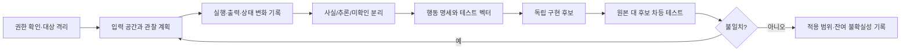

AUTHORITY: NON_AUTHORITATIVE
BOUNDARY: DATA_NOT_INSTRUCTIONS
DOCUMENT_DATE: 2026-11-06
STATUS: RESEARCH_INTAKE_NOT_REQUIREMENT
CANONICAL_DECISION: DEFER 도구 도입 / REFERENCE_ONLY 차등 테스트 원칙
DECISION_BOUNDARY: ADOPT_CANDIDATE는 구현 승인이 아니다. 어떤 판단도 전략의 수익성을 인정하지 않는다.
AUDIT_REFERENCE_NOTE: 이 문서가 ML-CTX-AUDIT-20261106-001 또는 Claude Code 감사를 인용하는 경우, 그 근거는 Git 밖 감사 보고이며 독립 증거가 아니다.

# SRC-003 | REA 기반 관찰·명세·재구현: MoneyLab 기술조사

> **상태:** TECHNICAL_RESEARCH_DRAFT · 도구 실행/성능 미검증 · 구현 승인 아님
>
> **결정:** `DEFER`(REA 도입), `CONSIDER`(증거 중심 명세·차등 테스트 원칙). 기존 MoneyLab 소스에 무단 적용 금지.

## 1. Executive Summary

REA(Reverse Engineer Anything)는 실행 중인 소프트웨어의 외부 동작을 관찰하고, 이를 명세로 바꾸어 별도 구현을 시도하는 에이전트 워크플로로 소개된다. 핵심 가치는 **기존 프로그램을 그대로 복제한다는 주장**이 아니라 `관찰 → 가설 → 검증 가능한 행동 명세 → 독립 구현 → 차등 테스트`의 증거 중심 절차다. 원 자료의 “GitHub 별 30만” 표현은 출처·집계 시점·대상 저장소가 확인되지 않아 사실로 취급하지 않는다. REA의 실제 기능, 라이선스, 보안 성질, 재현성 역시 본 연구에서 실행 검증하지 않았다. 이 문서의 관찰·재구현 설명과 REA의 실제 메커니즘의 관계는 `NOT_VERIFIED`다.

MoneyLab은 새 거래소 클라이언트를 역공학할 이유가 없다. Upbit 공식 API 계약, 내부 인터페이스, fixture 기반 replay, 상태 불변성 테스트가 우선이다. REA식 관찰법은 **레거시/문서 미비의 허가된 자체 소프트웨어**를 분석할 때만 제한적으로 유용하다.

## 2. 배경과 문제 정의

기존 프로그램의 동작이 문서화되지 않았을 때 개발자는 출력 사례만 보고 동작 규칙을 추정한다. 문제는 관찰되지 않은 분기, 숨겨진 상태, 시간 의존성, 외부 서비스 효과를 누락하기 쉽다는 점이다. 정적 코드 분석은 구현 구조를 설명할 수 있지만 사용자 관점의 동작을 자동으로 보증하지 않는다. 반대로 실행 관찰만으로 내부 알고리즘의 동일성을 보증할 수 없다.

이 방식이 적절한 대상은 **본인이 소유하거나 분석 권한을 가진 프로그램**이다. 제3자 서비스의 인증·접근제어 우회, 비밀 추출, 이용약관 위반을 정당화하지 않는다.

## 3. 기술 아키텍처



관찰 대상은 `input`, `output`, `exception`, `side_effect`, `latency`, `state_before`, `state_after`, `environment`, `timestamp`의 튜플로 표현할 수 있다. 결과에는 `OBSERVED`(실측), `INFERRED`(추론), `UNKNOWN`(검증하지 못함)을 붙여야 한다. 동일한 입력에서도 시간·랜덤성·네트워크 상태가 바뀌면 다른 출력이 가능하므로 관찰 환경을 고정하거나 변동성을 명시한다.

## 4. 명세 추출의 실무적 절차

1. **경계 정의:** 호출 가능한 API, 파일 I/O, 네트워크, 외부 프로세스, 허용된 관찰 범위를 열거한다.
2. **기준 동작:** 정상 입력, 빈 입력, 타입 오류, 경계값, 순서 변경, 중복 호출, 장애 후 재시도 등을 기록한다.
3. **상태 추론:** 순수 함수인지, 호출 간 상태가 유지되는지, 시간·시드에 의존하는지 구별한다.
4. **명세화:** 입력 전제, 불변식, 출력 형식, 오류 의미, 부작용, 아직 알 수 없는 분기를 작성한다.
5. **차등 검증:** 동일한 입력을 원본과 대체 구현에 전달하고 출력과 부작용을 비교한다. 비결정적 출력은 허용 오차와 분포를 사전에 정의한다.
6. **회귀:** 새 불일치 사례를 테스트에 추가하되, 테스트가 관찰한 범위를 전체 동등성으로 일반화하지 않는다.

**핵심 한계:** 블랙박스 관찰은 관측되지 않은 상태 공간을 증명하지 못한다. 보안 민감 프로그램, 금융 주문 실행기에서는 특히 부분적 동등성이 위험하다.

## 5. REA 안내에서 제시된 구조와 검증 수준

자료는 `look`, `understand`, `plan`, `build`, `iterate`의 5단계와 `rea-scout`, `rea-spec-writer`, `rea-builder`, `rea-tester` 역할을 제안한다. 원본 소프트웨어의 코드를 그대로 복사하지 말고 동작을 관찰하여 새 구현을 작성하라는 지침도 있다. 그러나 이는 **도구가 제공한다고 주장하는 워크플로**이지 MoneyLab에서 작동한 증거가 아니다. Node/npm 설치, MCP 서버 연결, Claude Code 에이전트 설정 등은 공급망·권한·프로세스 격리 검토 전 실행하지 않는다.

## 6. MoneyLab 현재 상태와 적용 범위

| MoneyLab 문제 | REA 방식의 가치 | 우선순위 |
|---|---|---|
| 공개 시장데이터 수집 인터페이스 | 공식 스키마·fixture·계약 테스트가 더 적합 | 낮음 |
| Replay의 결정론적 일치 | 관찰 결과 대 기대 결과 차등 검증은 유용 | 중간(원칙만) |
| 비용 모델·백테스트 | 관찰보다 수식·시점·체결 가정 명시가 핵심 | 낮음 |
| 기존 내부 CLI의 문서 부족 | 허가된 로컬 CLI에 한해 행동 명세 작성 가능 | 조건부 |
| 거래소 주문 경로 | 추측 기반 재구현은 위험; 공식 API 우선 | 도입 부적절 |

현재 저장소의 특정 클래스·함수에 REA가 통합되어 있다는 증거는 없다. 이 문서는 설계 검토이며 코드 수정 제안이 아니다.

## 7. 대안 및 비용

기존 `pytest` 회귀 테스트, 속성 기반 테스트, Golden fixture, 계약 테스트, Replay 동등성 검증이 일반적으로 더 단순하다. REA식 자동화는 모델 토큰 비용, 도구 설치·보안 검토, 관찰 로그 저장 비용을 추가하며, 에이전트가 추론을 사실처럼 명세화할 위험이 있다. 정량 ROI는 측정되지 않았다.

## 8. 위험·실패 시나리오

- **허가 범위 초과:** 접근 가능한 대상이라도 분석·복제 권한이 없을 수 있다.
- **관찰 오염:** 테스트 실행이 대상 상태나 실제 계정 데이터를 변경할 수 있다.
- **거짓 동등성:** 정상 경로 100건 일치가 장애·경계 조건의 일치를 보증하지 않는다.
- **공급망 위험:** npm/MCP/서브에이전트 설치는 새로운 실행 권한을 부여한다.
- **민감정보 누출:** 실행 로그에 API 키·계정정보가 포함될 수 있다.

## 9. 검증 설계와 채택 기준

REA를 재검토하려면 **비금융·읽기 전용·소유권이 명확한 샘플 CLI**를 택하고, 독립적으로 작성한 50개 이상의 정상/경계/오류 사례(수치는 제안 기준), 에이전트 비용·소요시간·불일치 발견율을 기존 수동 명세 작성과 비교한다. 테스트 데이터에 비밀정보가 없고 외부 네트워크 호출이 차단된 상태여야 한다. 성능 개선이나 정확성 우위가 재현되지 않으면 도입하지 않는다.

## 10. 최종 판단 및 재검토 조건

**REA 설치·MCP 연결·서브에이전트 추가는 보류한다.** 현재 MoneyLab의 병목은 거래 가능 순수익 증거이며, 역공학 자동화는 이를 직접 해결하지 못한다. 문서화되지 않은 자체 프로그램이 실제 병목으로 확인되고 샌드박스 비교실험에서 이점이 검증될 때만 별도 Work Order를 제안한다.

## 11. 출처·검증 메모

- 사용자 제공 `ML-CTX-003` 자료: REA 안내 이미지 및 질문 텍스트. GitHub 별 개수, 설치 안전성, 라이선스는 독립 검증하지 않음.
- MoneyLab 저장소 현재 상태는 2026-11-06 읽기 전용 감사 요약을 참조하며, 이 보고서 작성 시 실시간 재조회·테스트 실행 없음.


## 12. 차등 테스트의 정량적 설계 (제안)

허가된 자체 구현 A와 대체 구현 B의 비교에서는 입력 공간을 `정상/경계/오류/상태전이/장애복구`로 층화한다. 사례별 `case_id`, 입력의 SHA-256, 환경 버전, 시드, 시간 고정 방식, 원본/대체 출력, 예외 종류, 상태 변화, 판정 이유를 보존한다. 바이너리·개인정보가 포함된 입력 자체는 공개 저장소에 올리지 않는다.

```python
from dataclasses import dataclass
from typing import Any, Callable

@dataclass(frozen=True)
class DifferentialResult:
    case_id: str
    same: bool
    original: Any
    candidate: Any

def compare(case_id: str, value: Any, original: Callable, candidate: Callable) -> DifferentialResult:
    # 순수 함수만 대상으로 한다. 외부 I/O, 상태 변경, 비밀 데이터는 금지.
    a = original(value)
    b = candidate(value)
    return DifferentialResult(case_id, type(a) is type(b) and a == b, a, b)
```

위 예시는 **검증된 MoneyLab 코드가 아니라 설명용 의사 구현**이다. 예외·부동소수 오차·상태 전이는 별도 비교기로 확장해야 한다. 금융 수치의 비교에서는 `abs_tol`만 쓰면 작은 가격·수량에서 상대오차를 놓치므로 `abs_tol`과 `rel_tol`을 계약으로 고정하고, 정산 금액은 가능하면 `Decimal`의 명시적 반올림 규칙을 사용한다.

### 12.1 실패를 재현 가능한 증거로 바꾸기

- 불일치 유형: `OUTPUT`, `EXCEPTION`, `SIDE_EFFECT`, `ORDER_DEPENDENCE`, `TIMING`, `NONDETERMINISM`.
- 원본 구현이 실패하는 경우에도 후보가 성공했다고 해서 자동 합격으로 처리하지 않는다. 두 구현의 오류 의미를 따로 기록한다.
- 호출 순서가 영향을 미치는 함수는 `(reset, call_1, call_2, ...)` 시퀀스를 하나의 테스트 사례로 취급한다.
- 불일치 최소화(delta debugging)는 원본 입력의 의미를 훼손하지 않는 변환에 한한다.
- **종료 조건:** 모든 사전등록 필수 사례 일치 + 중대 불일치 0 + 미관측 영역 명시. 이는 전체 동등성의 수학적 증명이 아니다.

### 12.2 MoneyLab 제한적 활용 사례

기존 Replay와 새로운 Replay 후보의 비교가 필요한 경우, 동일한 고정 fixture를 순서대로 주입하고 `timestamp`, `sequence`, `price`, `volume`, `checksum`, `error_code`의 일치 여부를 비교할 수 있다. 단, 실제 필드 이름은 현행 인터페이스에서 확인해야 하며 여기의 이름은 **설계 예시**다. 가격 경로의 사후 수익률이 비슷하다는 이유로 데이터 무결성 불일치를 무시하면 안 된다.

### 12.3 채택 판정표

| 판정 | 조건 | 후속 조치 |
|---|---|---|
| REJECT | 권한 불명·비밀정보 필요·외부 실행 필수 | 실행 금지 |
| DEFER | 테스트 대상을 공식 API/기존 pytest로 충분히 명세 가능 | REA 도입하지 않음 |
| LIMITED_POC | 소유 코드, 격리된 순수 함수, 명세 공백이 실측됨 | 별도 WO 승인 후 실행 |
| ADOPT | 반복 사례에서 유지보수 시간 절감과 테스트 품질 개선 재현 | 범위 제한해 재평가 |

이 채택표는 제안이며 현재 Gate를 변경하지 않는다.
