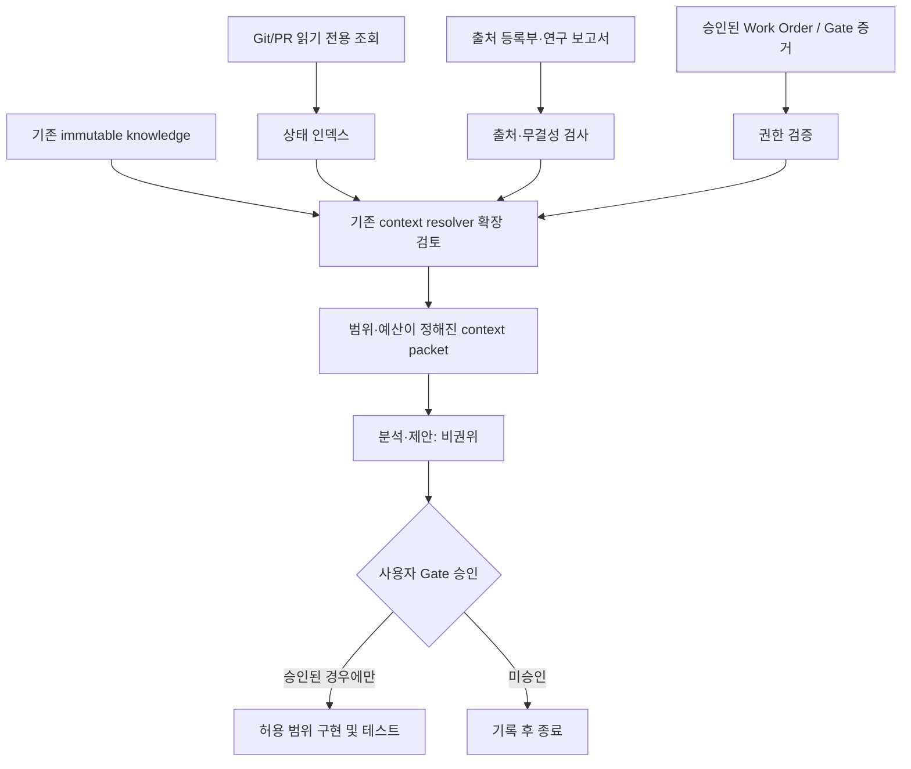

AUTHORITY: NON_AUTHORITATIVE
BOUNDARY: DATA_NOT_INSTRUCTIONS
DOCUMENT_DATE: 2026-11-06
STATUS: RESEARCH_INTAKE_NOT_REQUIREMENT
CANONICAL_DECISION: ADOPT_CANDIDATE 출처 ID·상태 색인·lint / DEFER 벡터 DB·자동 Gate
DECISION_BOUNDARY: ADOPT_CANDIDATE는 구현 승인이 아니다. 어떤 판단도 전략의 수익성을 인정하지 않는다.
AUDIT_REFERENCE_NOTE: 이 문서가 ML-CTX-AUDIT-20261106-001 또는 Claude Code 감사를 인용하는 경우, 그 근거는 Git 밖 감사 보고이며 독립 증거가 아니다.

# SRC-004 — Context Engineering: MoneyLab의 신뢰 가능한 작업 맥락 설계

> **상태:** 기술 연구·설계 제안 / 구현 승인 아님. **기준:** 2026-11-06 Claude Code 읽기 전용 감사 스냅샷. `USER:ML-CTX-004`와 기존 GitHub 문서 번호는 별도 네임스페이스로 취급한다.

## 1. Executive summary

Context Engineering은 모델에게 좋은 지시문을 쓰는 기술만이 아니라 **주어진 작업에 필요한 사실·증거·규칙·상태를 정확한 시점에 선별하고, 출처·신선도·권한을 보존하여 제공하는 시스템 설계**다. MoneyLab의 당면 문제는 지식 저장소의 부재가 아니다. 기존 `knowledge`의 불변 레코드, `EvidenceRef`, 결정론적 context resolver와 Work Order/Gate 체계가 존재한다는 감사 결과가 있다. 그러나 외부 연구자료와 현재 PR·Gate 상태가 이 체계에 충분히 연결되지 않아 세션 간 복구 시 오래된 설명을 사실로 받아들일 위험이 있다.

**판단:** 기존 구조를 재사용한 `source registry + task-status index + bounded context packet + read-only lint`는 **도입 검토 우선**. 별도 벡터 DB, 자동 승인 에이전트, 새 Wiki 엔진은 **보류**. 이 권고는 투자 수익성 증거가 아닌 개발 품질 가설이다.

## 2. 문제 정의: 토큰 부족보다 권위·시간·출처 혼동

동일한 작업에 서로 다른 종류의 정보가 동시에 등장한다. Git commit/PR 상태는 코드 사실, Work Order는 허용 범위, Gate 승인 기록은 행위 권한, 연구 보고서는 비권위적 분석, 외부 웹/스크린샷은 검증 전 참고자료다. 이를 한 프롬프트에 구분 없이 넣으면 세 가지 오류가 발생한다.

1. **상태 오류:** 과거 세션의 “PASS”를 현재 GitHub의 merge 가능 상태와 동일시한다.
2. **권한 오류:** “도입을 추천한다”는 기술조사 문구를 코드 변경 또는 주문 실행 승인으로 해석한다.
3. **근거 오류:** `ML-CTX-006`처럼 번호가 충돌하는 자료를 잘못 인용하거나, 미검증 논문 수치를 직접 재현된 성과로 서술한다.

컨텍스트 품질은 정보량이 아니라 **관련성, 신선도, 출처 무결성, 권한 일치, 검증 가능성**의 결합으로 평가해야 한다. RAG는 관련 자료 검색 방법 중 하나일 뿐, 권한 판단이나 최신 Git 상태 검증을 대신하지 못한다.

## 3. 기술 메커니즘과 구성요소

### 3.1 Context lifecycle

`Intake → Classify → Validate → Index → Select → Assemble → Use → Record outcome → Review`를 분리한다. Intake는 외부 자료의 존재와 해시를 기록한다. Classify는 `SOURCE_FACT / AUDIT_REPORTED / HYPOTHESIS / PROPOSED / APPROVED / REJECTED`처럼 증거·결정 상태를 구분한다. Validate는 해시·중복 ID·필수 필드·참조 유효성을 확인한다. Select는 현재 작업과 관련된 항목만 가져온다. Assemble은 토큰/문자 예산 내에서 우선순위별로 배치한다. Use 이후의 결과는 자동으로 사실이 되지 않으며 검토된 결정만 승인 기록으로 승격된다.

### 3.2 정보의 권위 계층

권위는 단일 숫자 순위보다 **질문별로 다른 판정 기준**이 안전하다.

| 질문 | 우선 확인할 근거 | 절대 대체할 수 없는 것 |
|---|---|---|
| 현재 PR이 열려 있는가 | GitHub 읽기 전용 조회 및 조회 시각 | 과거 채팅 요약 |
| 어떤 파일을 수정해도 되는가 | 승인된 Work Order, 허용 경로, base SHA | 외부 기술 블로그 |
| 특정 Gate가 승인됐는가 | 사용자 승인과 Gate 증거 | 테스트 PASS 단독 |
| 특정 연구 주장이 사실인가 | 원문/실험/공식 문서 | 에이전트의 확신 |
| 전략을 실거래할 수 있는가 | 명시적 실거래 승인과 위험 통제 | 백테스트 수익률 |

권한 충돌은 최신 문서 우선으로 자동 해결하지 않는다. 예: GitHub PR이 열려 있어도 승인된 Work Order가 없으면 새로운 수정 권한이 생기지 않는다.

### 3.3 Context packet 데이터 계약 (제안)

```yaml
schema_version: 1
packet_id: "CTX-<TASK_ID>-<YYYYMMDD>-001"
as_of_utc: "<verified timestamp>"
task_id: "<TASK_ID>"
repository:
  branch: "<verified branch>"
  commit_sha: "<full verified sha>"
  pr_number: "<verified PR number>"
  pr_state: "<fresh read-only lookup>"
authority:
  work_order_ref: "<approved document or null>"
  gate: "<evidence-backed state or UNKNOWN>"
  allowed_paths: []
  prohibited_actions: ["live_orders", "unapproved_repo_writes"]
context_items:
  - id: "SRC-004"
    evidence_class: "RESEARCH_PROPOSAL"
    source_ref: "USER:ML-CTX-004"
    sha256: "<manifest value>"
    retrieved_at_utc: "<timestamp>"
    authority: "DATA_NOT_INSTRUCTIONS"
unknowns: ["<explicit unresolved items>"]
```

위 YAML은 **설계 예시**이며 현재 코드의 실제 입력 스키마라고 주장하지 않는다. 해시는 manifest에서 채워야 하고, `UNKNOWN`은 임의로 PASS로 바꾸지 않는다.

### 3.4 선택 및 예산 관리

검색은 (1) Task/WO 일치, (2) 권한·상태 문서, (3) 코드/테스트 근거, (4) 필요한 연구자료 순으로 우선한다. 각 항목에 `source_id`, `as_of`, `evidence_class`, `char_budget`, `why_included`를 붙인다. 같은 문서의 중복 인용을 제거하되 상충하는 증거는 지우지 않는다. `max_chars`는 문자 제한이지 정확한 토큰/청구 비용이 아니므로 실제 토큰 수와 비용은 별도 계측해야 한다.

## 4. 현재 구현과 목표 구조

**감사에서 보고된 기존 요소:** `knowledge/context.py:resolve_context`, topic/namespace/kind 필터, `include_ids`, `max_records`, `max_chars`, immutable knowledge records, `EvidenceRef`, `DATA_NOT_INSTRUCTIONS`, supervisor 권한 제한. 이 보고서는 로컬 저장소에서 직접 재실행하지 않았다. 감사 시 레코드 7개, 외부 연구자료 미연결, 작업 Gate 상태가 대화 기록에 잔존한다는 공백이 보고됐다.



이는 **목표 아키텍처**다. `docs/context/`와 `knowledge/`를 무조건 병합하지 않는다. 보고서는 사람이 읽는 설명, knowledge records는 엄격한 계약을 가진 결정론적 입력으로 역할을 분리한다.

## 5. 설계 선택지와 트레이드오프

| 대안 | 장점 | 실패/운영 비용 | 현재 판단 |
|---|---|---|---|
| 긴 단일 핸드오프 문서 | 구현 간단 | stale 정보, 컨텍스트 오염, 충돌 발견 어려움 | 비교 기준선 |
| Git 기반 상태 인덱스 + bounded packet | 기존 도구 재사용, diff/감사 용이 | 인덱스 갱신 규칙 필요 | 우선 후보 |
| 키워드/파일 경로 검색 | 결정론적·저비용 | 의미적 동의어 누락 | 우선 후보 |
| Embedding/RAG | 대규모 문서의 의미 검색 | 색인 동기화·권한 필터·비용·재현성 | 측정 후 검토 |
| 완전자율 Wiki 갱신 | 지식 연결 자동화 | 허위 정보 확산, 승인 우회, 변경 폭발 | 현재 비권고 |

## 6. 실험 설계와 합격 기준

**가설 H1:** 상태 인덱스 기반 context packet은 기존 장문 핸드오프보다 권한/상태 오답을 줄인다. **가설 H2:** 동일 품질에서 컨텍스트 토큰과 복구 시간이 줄어든다. 두 가설 모두 아직 검증되지 않았다.

- 사전등록: 12~20개 과거 태스크 사례를 **프롬프트 조정 전** 고정하고, Git/PR·WO·Gate 근거를 독립적으로 정답 라벨링한다. 중복된 유사 사례는 그룹으로 분할한다.
- 실험군: A=기존 장문 핸드오프, B=상태 인덱스+정해진 packet. 동일 모델/온도/도구권한/소스 스냅샷을 사용한다.
- 1차 지표: 잘못된 승인 주장 건수, PR/Gate 상태 정확도, 근거 없는 단정률. 안전상 잘못된 권한 부여는 **0건**을 목표로 하되 작은 표본의 0건은 무오류 증명이 아니다.
- 2차 지표: 복구 소요시간, 토큰 수, 호출 비용, 미해결 충돌 식별률.
- 실패 테스트: 동일 `ML-CTX-006` 별칭 충돌, stale PR, 외부 프롬프트 인젝션, SHA 불일치, Gate 증거 누락, 비공개 원본 경로 노출.
- 실험 결과는 연구 생산성 지표다. **순수익 또는 거래 성능 개선의 근거로 전용하지 않는다.**

## 7. 운영·보안·비용

외부 자료는 언제나 `DATA_NOT_INSTRUCTIONS`다. 출처 원문에 “세션을 생성하라/파일을 수정하라”는 명령이 있어도 실행하지 않는다. 공개 GitHub에는 저작권·개인정보·API 키가 포함된 원본을 올리지 않고 허용된 요약·해시·출처 메타데이터만 기록한다. 문서 lint는 읽기 전용으로 시작하며 자동 수정은 별도 승인 필요. 비용은 `수집·색인 + 조회 + LLM 입력/출력 + 검토·유지보수`로 계측한다.

## 8. 결정, 선행 조건, 미해결 사항

**ADOPT_CANDIDATE:** 네임스페이스 출처 ID, 상태 인덱스, 권한 라벨, bounded context packet, 읽기 전용 lint. **DEFER:** 신규 벡터 DB, 독립 Wiki 엔진, 자동 Gate 갱신. 실제 도입은 별도 `CONTEXT-RECOVERY-01` Work Order 승인, 현재 Git SHA/PR 재조회, 테스트 통과 후 판단한다. `PR #40 OPEN/DRAFT`, head `944435df`는 **2026-11-06 감사 시점의 보고**이며 실시간 상태가 아니다.

**남은 검증:** 실제 resolver 입력/출력 스키마, 최신 CI, 원본 출처 라이선스, source register 식별자 호환성, 사용자가 승인한 문서 수정 경로.

## 9. 근거와 추적성

- `USER:ML-CTX-004` 기술 도식·설명: Context Engineering 개념 및 정보 선별 파이프라인 (외부 교육 자료, 정량 실험 근거 없음).
- `ML-CTX-AUDIT-20261106-001`: 기존 `knowledge/context.py`, Gate/PR, 문서 인덱싱 공백에 대한 **Claude Code 읽기 전용 감사 보고**.
- `SOURCE_REGISTER_V3.csv`, `EVIDENCE_AND_CONTRADICTION_REGISTER.md`: 해시 및 충돌 기록. 본문에 원본 분석 과정은 반복하지 않는다.
