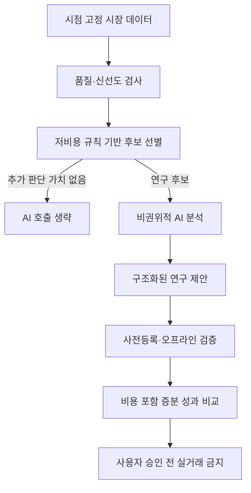

AUTHORITY: NON_AUTHORITATIVE
BOUNDARY: DATA_NOT_INSTRUCTIONS
DOCUMENT_DATE: 2026-11-06
STATUS: RESEARCH_INTAKE_NOT_REQUIREMENT
CANONICAL_DECISION: ADOPT_CANDIDATE 비용 회계 / DEFER AI 실호출·알파 결합 / REJECT_CANDIDATE 고빈도 LLM
DECISION_BOUNDARY: ADOPT_CANDIDATE는 구현 승인이 아니다. 어떤 판단도 전략의 수익성을 인정하지 않는다.
AUDIT_REFERENCE_NOTE: 이 문서가 ML-CTX-AUDIT-20261106-001 또는 Claude Code 감사를 인용하는 경우, 그 근거는 Git 밖 감사 보고이며 독립 증거가 아니다.

# SRC-005 — AI 에이전트 운영경제성과 알파 신호 결합

> **상태:** 기술조사 초안 / 구현 승인 아님
>
> **적용 대상:** MoneyLab의 연구 단계 및 장기적 24/7 Agentic Trading 목표
>
> **판정:** 운영비 회계와 의사결정 빈도 최적화는 **ADOPT_CANDIDATE**; 다중 알파 결합은 **DEFER**
>
> **증거 등급:** 비용 예시는 외부 사례의 산술적 설명, MoneyLab의 실제 운영 수익·비용은 **NOT_VERIFIED**.

## 1. Executive Summary

AI 트레이딩 시스템은 거래 전략의 기대수익이 양수라는 사실만으로 경제성이 성립하지 않는다. 거래 수수료, 스프레드, 시장 충격, 미체결과 더불어 모델 추론, 시장 데이터, 서버, 모니터링, 장애 대응 비용이 순수익을 잠식한다. 특히 소액 자본에서는 일정한 월간 고정비가 자본 대비 높은 수익률 요구로 환산된다. 그러므로 **전략 순손익(net trading PnL)**과 **시스템 순손익(net system PnL)**을 구분하고, AI 호출이 의사결정의 경제적 가치를 얼마나 개선했는지 비용 포함 증분 효과로 평가해야 한다.

별개의 연구 주제인 알파 결합은 여러 예측 신호를 정규화하고 공통 위험 노출을 제거한 뒤 결합하는 방법이다. 그러나 동일 BTC의 일봉 long/cash 전략에서 여러 신호가 존재한다는 것만으로 독립적인 알파가 확보되는 것은 아니다. 상관된 신호를 합치면 과적합과 거래회전율만 증가할 수 있다.

## 2. 문제 정의와 경제적 구조

AI 모델 호출 비용은 `입력 토큰 × 입력 단가 + 출력 토큰 × 출력 단가 + 기타 과금 항목`으로 계산한다. 실제 단가는 모델·제공자·캐시·배치·시점에 따라 달라지므로 **설정 파일에 검증일과 가격 출처를 기록**해야 한다. 실패 호출과 재시도, 프롬프트 길이 증가, 분석 빈도 증가도 비용에 포함한다.

시장 데이터 구독료, 클라우드, 저장소, 모니터링, 알림, 네트워크 비용은 AI 호출료와 별도로 계산한다. 개발을 위한 일회성 비용과 전략 운영을 위한 반복 비용은 다른 항목으로 회계 처리한다. 현금 보유의 기회비용과 세금은 평가 목적에 따라 별도 보고하되, 세후 수익으로 오인하지 않도록 평가 범위를 명시한다.

## 3. 핵심 손익 정의

기간 `T`에 대해 다음 두 회계 방식을 혼합하지 않는다.

**체결가 기반 방식**

```text
trading_net_T = Σ realized/unrealized PnL measured from actual/simulated fill prices
                - explicit trading fees
                - other separately charged execution costs
system_net_T  = trading_net_T
                - allocated model inference costs
                - allocated data/infrastructure/monitoring costs
```

체결가가 이미 호가·슬리피지를 반영했다면 spread/slippage를 다시 빼면 **이중 차감**이다. 반대로 mid-price 또는 이상적 종가를 기준으로 평가한다면 실행 가격 조정과 비용을 명시적으로 차감해야 한다. 미실현손익 평가가격, 현금 이자, 입출금 수수료, 세금 처리 여부를 보고서의 회계 정책에 고정한다.

**손익분기 자본 규모**는 `연간 시스템 고정비 / 연간 기대 순수익률`로 단순 계산할 수 있으나, 이는 수익률이 안정적이라는 비현실적 가정을 포함하는 **시나리오 산술**이지 투자 성과 예측이 아니다. 예를 들어 연간 고정비 18만 원과 가정상 연간 거래순수익률 3%라면 단순 손익분기 자본은 600만 원이다. 실제 기대수익률이 0 이하이면 유한한 손익분기 자본은 존재하지 않는다.

## 4. 호출 빈도와 의사결정 가치

하루 `N`회 모델 호출, 호출당 평균 `C`원, 연간 운영일 `D`일이면 `annual_model_cost = N × C × D`다. 암호화폐 시장은 24/7이므로 별도 중단 정책이 없다면 `D=365`가 기본이다. 주식 시장을 전제로 한 252거래일 예시를 그대로 적용하면 비용이 과소계상될 수 있다.

모델 호출을 줄이는 설계의 핵심은 **이벤트 기반 게이팅**이다. 1차 단계에서 결정론적 규칙으로 입력 품질과 변동성·시장상태·신호 유효성을 평가하고, 유의미한 추가 정보가 있을 때만 AI를 호출한다. 캐시나 배치도 비용을 낮출 수 있지만, 시점 정합성, 뉴스 최신성, 배치 지연으로 인한 신호 가치 소멸을 별도 검증해야 한다.



위 도식은 **제안 설계**이며 현재 구현 아키텍처를 뜻하지 않는다.

## 5. 알파 신호의 표준화·잔차화·결합

여러 신호 `s_i,t`를 결합할 때는 (1) 데이터 시점 정합성, (2) 훈련 구간에서만 추정한 평균·분산에 따른 정규화, (3) 공통 시장 요인에 대한 노출 통제, (4) 훈련 구간 내 가중치 추정, (5) 검증 구간에서의 비용 후 성과 측정이 필요하다.

단순 결합은 `S_t = Σ_i w_i z_i,t`이며, `Σ_i |w_i| = 1` 또는 사전등록된 별도 제약을 둘 수 있다. `z_i,t`의 평균·표준편차를 전체 데이터에서 계산하면 **미래 정보 누수**다. 공통 요인에 대한 잔차화도 동일하게 과거 구간에서 적합한 계수를 이후 구간에 적용해야 한다.

복잡한 최적화는 신호 수가 많고 표본이 적을 때 추정 오차를 증폭한다. 현재 단일 BTC long/cash 연구에서는 우선 단일 신호와 동등가중 결합을 기준선으로 두고, 증분 성과가 반복적으로 확인되기 전까지 복잡한 가중치 최적화를 도입하지 않는다. 원본 이미지의 알파 결합 수식은 특정 논문·코드의 재현성까지 검증된 것은 아니므로 **검증된 투자 공식으로 취급하지 않는다**.

## 6. MoneyLab 현재 상태와 격차

2026-11-06 Claude Code 읽기 전용 감사 보고에 따르면 거래손익과 기각 기준은 `pnl/ledger.py`, `pnl/report.py` 등에 존재하며, 비용 관련 코드로 `analytics/spot_costs.py`, `backtest/costs.py`가 확인됐다. 반면 시스템 운영비를 통합한 `net_system`, `ai_cost` 필드는 확인되지 않았고, LLM 실호출 경로와 다중 알파 결합 구현도 확인되지 않았다. 이는 **Claude 감사 보고에 의존한 상태**로, 최종 GitHub 반영 시 해당 커밋의 코드와 다시 대조해야 한다.

## 7. 권고 데이터 모델(제안, 미구현)

| 필드 | 단위 | 의미 | 검증 조건 |
|---|---|---|---|
| `strategy_id` | 문자열 | 사전등록된 전략 식별자 | 전략 정의 해시 연결 |
| `valuation_basis` | enum | `fill` 또는 `mark_to_mid` | 비용 이중 차감 방지 |
| `trading_net_krw` | KRW | 명시된 실행비용 차감 후 거래손익 | 회계 정책 고정 |
| `model_cost_krw` | KRW | 실제/가정 호출 비용 | 단가 버전, 호출 로그 |
| `data_cost_krw` | KRW | 데이터 비용 배분액 | 청구서 또는 가정 명시 |
| `infra_cost_krw` | KRW | 서버·저장소·모니터링 비용 | 동일 기간 배분 |
| `system_net_krw` | KRW | 거래순손익 - 운영비 | 재계산 가능 |
| `evidence_grade` | enum | 실제 청구 / 추정 / 합성 | 혼동 금지 |

## 8. 검증 설계

동일 기간·데이터 해시·실행 규칙을 고정한 뒤 `규칙 기반만 사용`과 `규칙 기반 + AI 호출`을 대응 비교한다. 1차 평가지표는 거래비용 차감 후 순손익이며, 시스템 채택 지표는 **AI·인프라 비용까지 차감한 증분 시스템 순손익**이다. 전략별 사전등록, 보류 데이터 1회 개방, 시계열 의존성을 반영한 블록 부트스트랩, 여러 모델·빈도·프롬프트 비교 시 다중검정 보정이 필요하다. 유의미한 수익성 근거가 없으면 AI 호출 최적화보다 **호출하지 않는 기준선**이 우선이다.

## 9. 실패 시나리오와 반론

- AI 판단의 정확도가 개선돼도 거래 기회가 드물거나 비용이 높으면 시스템 순손익이 악화된다.
- 모델 단가 인하만으로 시장의 거래비용·슬리피지를 해결할 수 없다.
- 이벤트 기반 호출이 극단적 시장 변화의 탐지율을 낮출 수 있다.
- 고정비를 임의로 여러 전략에 배분하면 전략별 경제성이 과대평가될 수 있다.
- 사후적으로 가장 저렴했던 모델과 최적 호출 빈도를 고르면 데이터 스누핑이다.
- 다중 알파가 동일한 시장 베타나 추세를 중복 측정할 수 있다.

## 10. 도입 결정 및 재검토 조건

**ADOPT_CANDIDATE — 비용 회계:** 코드 변경 이전에 비용 항목과 이중 차감 방지 규칙을 문서로 고정한다. 실제 청구서 또는 검증 가능한 가격표가 확보되면 실측/추정 비용을 분리한 보고서를 설계한다.

**DEFER — AI 실호출·다중 알파 결합:** 비용 차감 후 양의 성과를 보이는 단순 기준선, 시점 고정 데이터, 충분한 표본, 승인된 연구 계약이 확보되기 전에는 구현을 추진하지 않는다.

**REJECT_CANDIDATE — 수익성 근거 없는 24/7 고빈도 LLM 호출:** 호출 빈도를 높이는 것만으로 경제성을 주장할 수 없다.

## 11. 출처 및 추적성

- 사용자 제공 연구 분류 `USER:ML-CTX-005`에는 AI 호출 경제성 사례와 알파 결합 수식 자료가 함께 포함된다.
- Claude Code `ML-CTX-AUDIT-20261106-001` 최종 보고, `ML-CTX-005` 및 Context Engineering 구현 감사 섹션(2026-11-06). 코드 현황은 해당 감사의 보고 사실이며 이 문서 작성 과정에서 직접 실행·재검증하지 않았다.
- 외부 게시물의 모델별 가격과 투자 수익 주장: **NOT_VERIFIED**. 가격은 실제 도입 시 공급자 공식 문서에서 재확인해야 한다.
- 원본 파일 식별·해시와 기존 GitHub 문서 번호 충돌은 별도 `SOURCE_REGISTER_V3`에서 관리한다. 본문은 자료 분석 과정이 아닌 기술 설명을 중심으로 구성했다.
