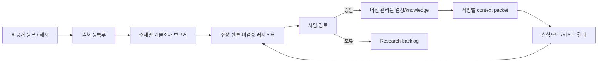

AUTHORITY: NON_AUTHORITATIVE
BOUNDARY: DATA_NOT_INSTRUCTIONS
DOCUMENT_DATE: 2026-11-06
STATUS: RESEARCH_INTAKE_NOT_REQUIREMENT
CANONICAL_DECISION: ADOPT_CANDIDATE 출처 연결·lint / DEFER 자동 Wiki·신규 DB
DECISION_BOUNDARY: ADOPT_CANDIDATE는 구현 승인이 아니다. 어떤 판단도 전략의 수익성을 인정하지 않는다.
AUDIT_REFERENCE_NOTE: 이 문서가 ML-CTX-AUDIT-20261106-001 또는 Claude Code 감사를 인용하는 경우, 그 근거는 Git 밖 감사 보고이며 독립 증거가 아니다.

# SRC-007 — Second Brain / LLM Wiki: 누적 지식과 검증 가능한 결정 기록

> **상태:** 연구 설계 제안 / 미승인. 출처 별칭 `USER:ML-CTX-007` / `ZIP:007`; 카파시의 직접 발언·성능은 독립 검증되지 않았다.

## 1. Executive summary

Second Brain은 단순 문서 저장소가 아니라 **새 정보를 기존 지식과 연결하고, 질문·결정·반증을 다음 작업에 재사용할 수 있게 하는 지식 운영 방식**이다. 핵심은 `raw evidence → structured concepts → claims/decisions → retrieval → feedback`이다. MoneyLab에는 이미 Git 기반 문서, immutable knowledge records, Context resolver가 존재한다고 감사에서 보고됐다. 따라서 새 Wiki를 만드는 것보다 **연구 보고서, 출처, 승인된 결정, 현재 작업 상태의 연결 관계**를 강화하는 것이 비용과 권한 측면에서 우선이다.

**판단:** 문서 색인, 양방향 참조, 변경 이력, 모순 검사, 출처 분리는 도입 후보. LLM의 자율적 대량 문서 수정과 승인된 knowledge 자동 승격은 현 단계에서 부적절하다.

## 2. 개념과 기존 RAG와의 관계

검색 기반 RAG는 질문이 들어올 때 원문 조각을 찾고 모델에게 전달한다. Wiki 기반 방식은 자료가 들어올 때 개념·관계·요약을 미리 구조화한다. **양자는 상호 배타적이지 않다.** Wiki도 원문 검증을 위한 검색이 필요하고, RAG도 장기 유지되는 지식 레이어를 사용할 수 있다. Wiki의 장점은 인간이 이해하기 쉬운 연결 구조와 Git diff다. 약점은 초기 요약 오류가 후속 페이지에 전파되고, 자동 업데이트가 사실과 판단을 혼동하기 쉽다는 점이다.



이 그림은 제안 구조다. 원문이 'ground truth'라는 표현은 **원문에 무엇이 쓰였는지에 대한 증거**라는 뜻이지, 원문 주장 자체가 참이라는 의미가 아니다.

## 3. 데이터 모델: 문서와 지식을 구분한다

| 객체 | 역할 | 변경 정책 | 권위 |
|---|---|---|---|
| `Source` | 원문 위치, SHA-256, 저자·버전·라이선스 | 해시 불변; 정정은 새 기록 | 원문 존재 증거 |
| `ResearchReport` | 기술 원리·비판·대안·적용성 | 리뷰 가능한 Git diff | 비권위적 분석 |
| `Claim` | 검증 가능한 단일 주장 | 근거/반론/상태 연결 | 증거 수준별 |
| `Decision` | 채택·보류·기각 사유와 승인자 | 승인·supersedes 기록 | 명시적 승인 범위 내 |
| `TaskState` | WO, Gate, PR, SHA, CI | 시점·조회 근거 필수 | 작업 상태 조회 |
| `KnowledgeRecord` | 기존 결정론적 resolver 입력 | 기존 불변 스키마 준수 | 코드의 권한 제한에 종속 |

출처 식별자는 `USER:ML-CTX-006`, `DOC:ML-CTX-006`처럼 네임스페이스를 유지한다. `SRC-006`은 새 연구 보고서 별칭이며 과거 GitHub 파일명을 소급 변경하지 않는다.

### 3.1 관계형 참조 예시 (제안, 현행 스키마 아님)

```yaml
report_id: SRC-007
source_refs: ["USER:ML-CTX-007"]
claims:
  - id: "CLAIM-SRC007-01"
    text: "인덱스 기반 지식 재사용이 작업 복구 시간을 줄일 수 있다"
    evidence_class: "HYPOTHESIS"
    verification: "paired recovery benchmark pending"
    decision: "DEFER_AUTOMATION"
links:
  related_reports: ["SRC-004", "SRC-011"]
  task_contract: "CONTEXT-RECOVERY-01 (PROPOSED)"
```

이 구조를 그대로 기존 `knowledge`에 쓰지 않는다. 스키마 호환성을 먼저 검사하고 새 필드가 필요하면 별도 WO·마이그레이션 계획을 요구한다.

## 4. Ingest / Query / Lint의 정확한 동작

### Ingest

1. 원본 해시와 접근 권한을 등록한다. 라이선스 미확인 원문은 공개 저장소에 복제하지 않는다.
2. 기존 ID·중복 출처·판본 차이를 확인한다.
3. 보고서 초안을 작성하면서 사실·추론·미검증 주장을 분리한다.
4. 연관 문서의 **수정 제안 목록**을 생성한다. '10~15개 페이지 자동 변경'은 규칙으로 채택하지 않는다.
5. 검토자가 diff와 승인 범위를 확인한 뒤 반영한다.

### Query

질문 → 현재 작업/권한 확인 → 관련 보고서·결정·코드 증거 선택 → 근거를 첨부한 답변 → 불확실성 표시. 유용한 답변이라도 자동으로 지식 레코드가 되지 않는다. 새 주장 또는 변경 제안으로 기록하고 검토한다.

### Lint

읽기 전용 규칙: ID 충돌, 끊어진 상대 링크, 누락된 SHA/출처, 문서의 `as_of` 부재, 같은 PR에 대한 서로 다른 상태, 승인 없는 `IMPLEMENTED` 문구, 비공개 경로·민감정보 노출, 오래된 `current` 표현을 탐지한다. 단순 문자열 비교는 문맥을 이해하지 못하므로 **경고와 근거 위치**를 출력하고 자동 수정하지 않는다.

```text
WARN ID_COLLISION  USER:ML-CTX-006 != DOC:ML-CTX-006
WARN STALE_STATUS  PR#40 status asserted without as_of timestamp
WARN AUTHORITY     Research report claims implementation approval
PASS SOURCE_HASH   source reference matches registered SHA-256
```

위 출력은 예시다. 실제 lint 실행 결과가 아니다.

## 5. MoneyLab 현재 구조와 최소 통합

감사에서 보고된 `knowledge` 불변 레코드, `EvidenceRef`, `resolve_context`, `docs/context/` 및 Git Work Order를 우선 재사용한다. 새 위키 데이터베이스를 만들면 동일한 상태를 Git·Wiki·보드에서 세 번 관리하게 되어 **split-brain** 위험이 증가한다. 따라서 Git/PR을 코드 사실의 원천으로, 승인된 WO/Gate를 행위 권한의 원천으로, 보고서를 기술 해석의 원천으로 분리한다.

최소 도입 순서는 `SOURCE_REGISTER_V3` 제안 검토 → `TASK_STATUS_INDEX` 조회 기준 수립 → 문서 인덱스·링크 검증 → read-only lint → 세션 복구 실험이다. 이 과정에서 원본 ZIP의 공개 업로드나 기존 불변 레코드 일괄 수정은 필요하지 않다.

## 6. 성능 검증 설계

**검증 질문:** Wiki형 색인이 장문 요약이나 파일 검색보다 실제로 나은가?

- 데이터셋: 출처 충돌, PR 상태 변경, Gate 승인 증거 누락, 상충하는 논문 결과, 수정 금지 경로를 포함한 과거 12~20개 질의.
- 기준선: 기존 handoff, Git grep/경로 검색, 인덱스 기반 packet. 동일한 Git 스냅샷과 모델·도구 권한.
- 1차 지표: 정확한 출처 회수율, 권한 오분류율, 허위 구현 주장률. 2차: 복구 시간, 토큰/호출 비용, 문서 수정 건수.
- 유의점: Wiki가 스스로 작성한 답을 정답으로 채점하지 않는다. 독립 검토한 Git/WO/원문 증거로 라벨링한다. 같은 태스크의 유사 질문이 훈련/평가 양쪽에 들어가지 않도록 그룹 분할한다.
- 실패 기준: 비권위 자료가 승인 근거로 승격되거나, lint가 사용자 승인 없이 파일을 수정하거나, 원본 비공개 정보가 유출되면 도입 중단.

## 7. 비용·보안·실패 시나리오

위키 구축 비용은 초기 요약 토큰보다 **문서 정정, 판본 충돌 처리, 검토자의 승인 시간, 잘못된 참조의 전파 비용**이 크다. 변경 제안이 수십 파일에 걸치면 리뷰 부담과 회귀 위험이 커진다. Git diff를 작은 승인 단위로 제한하고, 외부 문서의 명령문을 실행하지 않으며, 개인정보·계정·키·비공개 원문을 공용 문서로 옮기지 않는다.

## 8. 채택 판단 및 재검토 기준

**ADOPT_CANDIDATE:** Source Register, 인덱스, 출처-주장-결정 링크, read-only lint, 검토된 지식 승격. **DEFER:** LLM 자동 위키 유지보수, Obsidian/벡터 DB 신규 의존성, 승인 없는 자동 수정. 실제 도입에는 별도 `CONTEXT-RECOVERY-01` WO, 최신 Git 검증, 회귀 테스트가 필요하다.

**미검증:** 외부에서 전해진 '약 100문서·40만 단어' 규모 주장과 특정 인물의 사용 방식, 실제 MoneyLab 스키마 호환성, 문서 인덱스 도입의 측정된 이득.

## 9. 참고 및 추적성

- `USER:ML-CTX-007`: Second Brain / LLM Wiki 개념 및 Ingest/Query/Lint 주장. 외부 인물의 직접 출처로 확정하지 않음.
- `ML-CTX-AUDIT-20261106-001`: MoneyLab 문서·knowledge 구조에 대한 **감사 보고**, 직접 재실행 아님.
- `SRC-004`, `SRC-011`: 맥락 선택 및 작업 오케스트레이션 관련 보고서.
