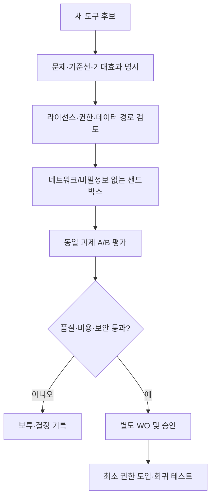

AUTHORITY: NON_AUTHORITATIVE
BOUNDARY: DATA_NOT_INSTRUCTIONS
DOCUMENT_DATE: 2026-11-06
STATUS: RESEARCH_INTAKE_NOT_REQUIREMENT
CANONICAL_DECISION: ADOPT_CANDIDATE 평가 절차 / DEFER 도구 도입
DECISION_BOUNDARY: ADOPT_CANDIDATE는 구현 승인이 아니다. 어떤 판단도 전략의 수익성을 인정하지 않는다.
AUDIT_REFERENCE_NOTE: 이 문서가 ML-CTX-AUDIT-20261106-001 또는 Claude Code 감사를 인용하는 경우, 그 근거는 Git 밖 감사 보고이며 독립 증거가 아니다.

# SRC-008 | AI 개발 도구 도입의 경제성·공급망 위험·Context 통합: MoneyLab 기술조사

> **상태:** TECHNICAL_RESEARCH_DRAFT · 외부 도구 최신 상태/인기도 미검증 · 설치 승인 아님
>
> **결정:** `CONSIDER`(도구 평가 절차), `DEFER`(목록 일괄 도입).

## 1. Executive Summary

개발 도구의 인기 순위는 프로젝트 생산성의 직접 증거가 아니다. MoneyLab의 우선순위는 테스트·근거·작업 격리·권한 경계를 보존하면서 **검증된 개발 시간을 줄이는가**이다. 자료에 제시된 GitHub 별 증가량, 순위, 사용성 주장은 해당 게시 시점의 주장으로만 취급한다. 도구 11개를 한꺼번에 설치하면 오히려 MCP·브라우저·CLI 권한 표면, 설정 충돌, 추적 비용이 증가한다.

## 2. 후보의 기능별 분류

| 후보 | 자료상 역할 | MoneyLab 연결 | 사전 검토 |
|---|---|---|---|
| VoiceStudio | 음성 합성/더빙 | 연구·CI와 직접 관련 낮음 | 보류 |
| ponytail | 게임 개발 보조 | 현재 업무와 낮은 관련성 | 보류 |
| security-audit-skill | 코딩 AI 보안 감사 | 에이전트 권한·비밀 보호 | 별도 읽기 전용 PoC 가능 |
| ECC | 코딩 에이전트 스킬 묶음 | 작업 표준화 가능성 | 기능 중복·프롬프트 권한 확인 |
| impeccable | 디자인 보조 | 포트폴리오 UI가 생기면 검토 | 보류 |
| hyperframes | HTML→영상 | 현 목표와 낮은 관련성 | 보류 |
| Agent-Reach | 외부 콘텐츠 읽기 | 출처 수집·프롬프트 인젝션 표면 확대 | 보류 |
| ghidra | 바이너리 분석 | 금융 연구와 직접 관련 낮음 | 보류 |
| taste-skill | 디자인 감각 지침 | README 품질과 무관한 부분 많음 | 보류 |
| freellmapi | 모델 호출 라우팅 주장 | 비용 최적화 가능성 | 보안·약관·안정성 확인 전 금지 |
| DeepInfer | 추론 엔진 주장 | 추론비 최적화 가설 | 동일 품질·비용 비교 필요 |

표의 제품 기능은 자료에 나온 **설명**이며, 실제 제공 범위·안전성·라이선스가 검증되었다는 의미가 아니다. 일부는 실행 도구가 아니라 스킬/프롬프트 패키지다.

## 3. 문제 정의: 도구 추가와 시스템 성과의 차이

MoneyLab은 Python 3.14, pytest, Claude Code, GitHub Actions, 다수의 작업 Worktree를 사용한다는 과거 감사 맥락이 있다. 도구를 추가하면 설치 시간뿐 아니라 버전 충돌, 비밀정보 노출, 유지보수, 에이전트 결과의 재현성 문제가 생긴다. 도구 선택의 목적함수는 GitHub stars가 아니라 다음과 같다.

`Net Tool Value = 검증된 작업시간 절감 가치 + 오류 감소 가치 − 라이선스/호출료 − 유지보수 − 보안·복구 기대비용`.

위 값의 금액 환산은 평가용 개념이며 현재 측정치가 아니다.

## 4. 권장 도입 아키텍처



새 도구는 `TOOL_ID`, `version/commit`, `license`, `install_source`, `permissions`, `network_endpoints`, `secrets_access`, `data_retention`, `test_task`, `baseline`, `quality_metric`, `token_cost`, `rollback`을 기록한 뒤 검토한다.

## 5. 평가 실험 설계

비교 과제는 기존 MoneyLab에서 실제 반복되는 **읽기 전용 문서 검색, pytest 실패 원인 분류, PR 설명 초안, 보안 정적 검토** 등으로 한정한다. 동일한 입력, 동일한 코드 기준선, 동일한 평가 기준을 사용한다. 작업당 소요시간, 수정된 파일 수, 오탐·누락, 재실행 성공률, 토큰/호출 비용을 측정한다. 단일 데모 성공이나 LLM 자기평가 점수만으로 채택하지 않는다.

보안 감사 스킬은 오탐과 누락이 모두 존재할 수 있으므로 정적 분석·테스트의 대체재가 아니다. 외부 콘텐츠 수집기는 검색 결과의 명령문을 **데이터**로 취급하고 로컬 파일/명령 실행 권한을 부여하지 않아야 한다.

## 6. Context Engineering과의 연결

자료에 보이는 `MASTER_CONTEXT`와 `ML-CTX` 문서 목록은 **문서가 존재한다는 화면**이지, 최신 상태를 자동으로 검색하거나 Work Order 권한을 동기화한다는 증거가 아니다. 따라서 도구 추가보다 먼저 `Source Register → Research Reports → Decision Records → Task Status Index`를 연결해야 한다. 자료 번호가 기존 GitHub 문서와 충돌할 수 있으므로 신규 원본은 `SRC-NNN`과 별도 alias로 식별한다.

## 7. 비용·실패 시나리오

- 모델 라우터가 무료라고 광고하더라도 API 키 위탁, 데이터 재사용, 속도 제한, 장애 비용을 확인해야 한다.
- 코드 실행 스킬이 자동 승인 정책을 바꾸면 테스트를 통과해도 운영 위험이 커진다.
- 도구 버전이 바뀌면 이전 평가가 무효가 될 수 있다. 커밋/릴리스 고정과 롤백 경로가 필요하다.
- GitHub stars는 조작·일시적 유행·홍보 영향이 있으며 코드 품질 보증 지표가 아니다.

## 8. MoneyLab 채택 결정

현재 **일괄 설치는 기각**, 특정 반복 업무의 병목이 계측되면 도구 하나만 격리 PoC를 허용하는 방향을 권고한다. `security-audit-skill`도 자동 실행 없이 먼저 내용·권한·라이선스를 읽기 전용으로 검토해야 한다. GitHub 문서 개선은 별도 도구 도입 없이 가능하다.

## 9. 출처·검증 메모

- 사용자 제공 `ML-CTX-008` 이미지 두 장: 도구 후보 목록 및 GitHub 문서 화면.
- 순위·별 증가량·공식 기능·현행 릴리스는 독립 확인하지 않았다. `SRC-010`과 동일한 후보 목록은 **중복 증거**로 취급하며 서로 독립된 검증 사례로 세지 않는다.


## 10. 보안 평가를 실행 계약으로 구체화 (제안)

도구 설치의 최소 단위는 저장소가 아니라 **권한 집합(capability set)**이다. 평가표에는 `filesystem_read`, `filesystem_write`, `shell`, `network`, `git_push`, `secret_read`, `external_upload`의 허용 여부를 각각 기록한다. MoneyLab의 연구용 기본값은 `read-only`, `no secrets`, `no network`, `no repo mutation`이다. 도구가 이 권한을 필요로 한다면 단순 설정 변경이 아니라 별도 Work Order 및 사용자 승인이 필요하다.

| 위험 사건 | 탐지·차단 설계 | 검증 증거 |
|---|---|---|
| 프롬프트 인젝션 | 외부 문서 내용은 `DATA_NOT_INSTRUCTIONS`로 격리 | 악성 지시 fixture에서 명령 미실행 |
| 비밀정보 외부 전송 | 토큰 없는 샌드박스·egress 차단 | 네트워크 로그와 환경변수 검사 |
| 승인 우회 | 제안 출력에 실행/승인 권한 없음 | Gate 변경 불가 테스트 |
| 의존성 공급망 변조 | 커밋 고정·해시/라이선스 검토 | 잠금 파일·아티팩트 해시 |
| 결과 오염 | 원본 fixture 불변·출력 별도 저장 | 전후 SHA-256 비교 |

### 10.1 동일 과제 A/B 측정 방법

`baseline=기존 Claude Code + 현재 Guard`와 `candidate=기존 환경 + 도구 하나`를 비교한다. 각 과제는 독립된 깨끗한 worktree와 동일한 입력을 사용하고, 작업 순서를 무작위로 교차해 학습 효과를 줄인다. 성공은 `pytest`만이 아니라 **사전 정의된 수용 테스트, 금지 동작 0건, 리뷰 수정량, 총 소요시간**으로 측정한다.

- `success_rate = accepted_tasks / attempted_tasks`
- `total_cost = model_calls + tool_fees + reviewer_minutes × hourly_cost + recovery_cost`
- `time_saved = median(baseline_duration) - median(candidate_duration)`
- `security_violation_count`는 평균 점수에 합산하지 않고 **독립적인 실패 Gate**로 둔다.

위 비용식은 평가 계약이며 실측 결과가 아니다. 표본이 적으면 우연한 과제 난도 차이가 크므로 성능 향상을 확정하지 않고 신뢰구간 및 과제별 결과를 함께 기록한다.

### 10.2 증거 카드 예시

```yaml
tool_id: candidate-001
source_commit: UNVERIFIED
license: UNVERIFIED
capabilities: [filesystem_read]
network: denied
secrets: denied
benchmark_task_set: UNDEFINED
baseline_sha: UNVERIFIED
quality_gate: NOT_RUN
security_gate: NOT_RUN
decision: DEFER
```

이는 도입을 승인하는 설정 파일이 아니라 **검토 기록의 예시**다. 실제 저장소 파일로 생성하지 않는다.

### 10.3 기존 구성과의 충돌 방지

Knowledge record는 Git 추적 불변 기록이고, Supervisor 제안은 `NON_AUTHORITATIVE_PROPOSAL`이다. 새 도구가 자체 메모리나 벡터 검색 결과를 생성하더라도 그것은 **파생된 비권위적 뷰**여야 한다. Guard가 개발 에이전트 명령을 막는다는 사실을 운영 환경의 주문 차단 장치로 오인하지 않는다.
