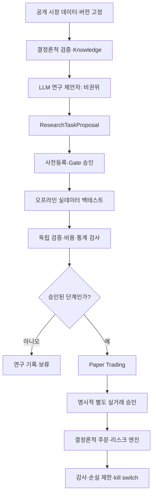

AUTHORITY: NON_AUTHORITATIVE
BOUNDARY: DATA_NOT_INSTRUCTIONS
DOCUMENT_DATE: 2026-11-06
STATUS: RESEARCH_INTAKE_NOT_REQUIREMENT
CANONICAL_DECISION: ADOPT_CANDIDATE 최소 권한·관찰성 / DEFER 다중 에이전트 확장
DECISION_BOUNDARY: ADOPT_CANDIDATE는 구현 승인이 아니다. 어떤 판단도 전략의 수익성을 인정하지 않는다.
AUDIT_REFERENCE_NOTE: 이 문서가 ML-CTX-AUDIT-20261106-001 또는 Claude Code 감사를 인용하는 경우, 그 근거는 Git 밖 감사 보고이며 독립 증거가 아니다.

# SRC-009 | Agentic AI 개발 패턴·평가·권한 경계: MoneyLab 기술조사

> **상태:** TECHNICAL_RESEARCH_DRAFT · 구현 승인 아님
>
> **결정:** `ADOPT_AS_DESIGN_PRINCIPLE`(최소 권한·검증·관찰성), `DEFER`(다중 에이전트 구조 확장).

## 1. Executive Summary

에이전트 시스템은 모델이 똑똑해지는 것만으로 안정화되지 않는다. **도구 권한, 상태 전이, 작업 분해, 실패 복구, 관찰성, 평가 기준**을 명시해야 한다. 자료에는 Agentic AI 개발 로드맵, 아홉 가지 설계 패턴, 구현 가이드가 제시되어 있다. 이들은 학습·설계 참고 체계이며 특정 프레임워크가 MoneyLab에서 검증되었다는 증거는 아니다.

MoneyLab에는 `Research Proposal`을 만드는 비권위적 AI 기능과 거래 실행 권한을 분리하는 원칙이 특히 중요하다. 에이전트가 연구 결과를 요약할 수는 있어도 전략 검증 통과, 위험 한도 변경, 주문 승인 여부를 독자적으로 결정해서는 안 된다.

## 2. 시스템 계층과 설계 기준

**기초 계층:** Python, 데이터 형식, API/HTTP, 상태·오류 처리, 재현 가능한 환경.

**모델 계층:** 추론 모델, 컨텍스트 창, 구조화 출력, 비용·지연·모델 버전 관리.

**지식 계층:** Retrieval, Memory, 출처·유효기간, 접근 통제.

**도구 계층:** 파일·브라우저·코드·거래 API의 개별 권한 및 감사.

**오케스트레이션 계층:** 작업 상태, 승인 지점, 재시도, 병렬성.

**검증 계층:** 결정론적 테스트, 평가 데이터셋, 운영 관찰성.

**배포 계층:** CI, 환경 분리, 롤백, kill switch, 비밀정보 관리.

핵심 원칙은 **연구 환경의 자유도와 주문 실행 환경의 권한을 동일시하지 않는 것**이다.

## 3. 아홉 가지 패턴의 작동 원리와 적용 판단

| 패턴 | 기술 원리 | 적합한 용도 | 주요 실패 모드 | MoneyLab 판단 |
|---|---|---|---|---|
| Tool Use | 모델이 구조화된 도구 호출 제안 | 읽기 전용 데이터 조회 | 권한 과다·인자 오염 | 제한적으로 사용 |
| ReAct | 관찰-추론-행동을 반복 | 탐색적 분석 | 무한 루프·비용 폭증 | 연구 전용 |
| Reflection | 산출물 자기 점검 | 문서·코드 초안 | 자기확증 편향 | 독립 테스트와 병행 |
| Planning | 작업을 의존성 단계로 분해 | Work Order 설계 | 계획 변경·범위 이탈 | 승인 Gate와 결합 |
| Orchestration | 역할별 작업 조정 | 다중 자료 검토 | 상태 충돌·권한 전이 | 필요성 검증 전 보류 |
| Sequential Chain | 순차 처리·검증 | 데이터 검증 파이프라인 | 앞단 오류 전파 | 결정론적 구현 우선 |
| Parallel Fan-out/Fan-in | 독립 작업 병렬 처리 후 통합 | 독립 문서 검토 | 합의 착각·비용 증가 | 제한적 연구 후보 |
| Hierarchical | 감독자-하위 작업자 | 복잡한 연구 작업 | 감독자의 근거 없는 승인 | 비권위적 감독만 |
| P2P Mesh | 에이전트 간 직접 교신 | 분산 협업 실험 | 추적·책임 소재 불명 | 현 단계 부적합 |

패턴은 조합할 수 있지만 복잡도가 증가한다. 단일 에이전트 + 결정론적 도구로 해결되는 문제에 다중 에이전트를 도입할 이유는 없다.

## 4. 권한 경계 중심의 아키텍처

위 그림은 **목표 상태의 논리 구조**이며 실제로 모든 구성요소가 존재한다는 주장이 아니다. LLM 출력은 어떤 경로로도 주문·승인·비밀정보를 직접 조작할 수 없어야 한다.

## 5. 에이전트 상태와 실패 복구

장기 실행 작업에는 `task_id`, `parent_task_id`, `work_order_id`, `scope`, `read_permissions`, `write_permissions`, `attempt`, `deadline`, `budget`, `input_digest`, `artifact_digest`, `status`, `approval_id`가 필요하다. 상태는 예컨대 `PROPOSED → APPROVED → RUNNING → EVALUATED → CLOSED`로 제한한다. 실패는 `FAILED`로 기록하고 재시도는 동일 작업의 새로운 시도 번호를 갖는다. `approval_id`가 없으면 승인된 작업으로 전이할 수 없다는 불변식을 테스트한다.

다중 에이전트가 동일 파일을 편집하면 race condition과 merge conflict가 생긴다. 작업 디렉터리 격리, 단일 writer, 결과 해시 확인이 필요하다. 사용자의 별도 승인 없이 GitHub push/merge를 수행하지 않는다.

## 6. 평가와 관찰성

개발 에이전트 평가에는 코드 컴파일 성공률보다 **요구사항 충족률, 허용 파일만 수정했는지, 회귀 테스트, 작업 재현성, 보안 위반 건수, 총 토큰 비용**이 중요하다. 각 작업의 입력·모델 버전·도구 호출·결과 해시·테스트 로그를 추적한다. 트레이딩 성과는 이와 별개로 **실데이터 out-of-sample 비용 차감 순손익**으로 평가한다.

다중 에이전트가 여러 번 동일한 잘못된 전제를 반복하면 합의가 높아져도 정확성은 높아지지 않는다. 독립 데이터와 독립 평가자를 두어야 한다. 다중 에이전트 토론의 수익성 관련 연구는 `SRC-012`와 구분한다.

## 7. MoneyLab 현재 구현과의 관계

2026-11-06 이전 읽기 전용 감사에 따르면 `knowledge/`, `supervisor/`의 비권위적 ResearchTaskProposal 및 결정론적 경계가 존재한다. 반면 외부 출처 자동 수집, 현재 Gate 상태의 지속적 인덱싱, Paper/실거래 전 과정은 완료된 것으로 확인되지 않았다. 구체적 파일 경로·커밋·CI 상태는 후속 코드 감사에서 재검증해야 한다. 기존 설계를 무시한 새로운 프레임워크 설치는 피한다.

## 8. 위험·비용·검증 실험

- **프롬프트 인젝션:** 검색·문서의 명령문은 신뢰할 수 없는 데이터다.
- **권한 상승:** 모델이 승인 문구를 생성했다고 승인 기록이 생기는 것은 아니다.
- **비결정성:** 동일 입력의 출력 차이를 허용하되 Gate 판정은 결정론적이어야 한다.
- **비용:** 다중 모델 호출이 단일 모델보다 품질을 개선한다는 가정은 검증 대상이다.

PoC가 필요하다면 동일한 문서 검토 과제를 `단일 에이전트`, `단일 에이전트+독립 검증`, `다중 에이전트`로 나누어 오류 검출률·재현성·토큰 비용을 사전등록 비교한다. 거래 전략 holdout을 사용하지 않는다.

## 9. 최종 판단

**최소 권한·상태 전이·평가·관찰성은 설계 원칙으로 유지**, 프레임워크·다중 에이전트 확장은 실제 병목과 비교 실험이 확인될 때만 제안한다. 구현은 별도 승인 Work Order가 필요하다.

## 10. 출처·검증 메모

- 사용자 제공 `ML-CTX-009` 3개 도식: 로드맵, 9가지 설계 패턴, 구현 가이드.
- 도식의 개별 라이브러리/프레임워크 최신 기능은 검증하지 않았다. 기존 GitHub의 동명 문서와 원본 주제가 다를 수 있어 `SRC-009` alias로 구분한다.
