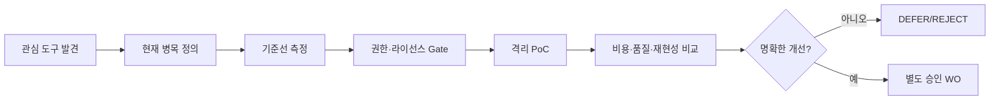

AUTHORITY: NON_AUTHORITATIVE
BOUNDARY: DATA_NOT_INSTRUCTIONS
DOCUMENT_DATE: 2026-11-06
STATUS: RESEARCH_INTAKE_NOT_REQUIREMENT
CANONICAL_DECISION: REJECT_CANDIDATE 인기 순위 근거 사용 / ADOPT_CANDIDATE 문제 중심 절차
DECISION_BOUNDARY: ADOPT_CANDIDATE는 구현 승인이 아니다. 어떤 판단도 전략의 수익성을 인정하지 않는다.
AUDIT_REFERENCE_NOTE: 이 문서가 ML-CTX-AUDIT-20261106-001 또는 Claude Code 감사를 인용하는 경우, 그 근거는 Git 밖 감사 보고이며 독립 증거가 아니다.

# SRC-010 | AI 개발 도구 트렌드의 검증 가능성과 도입 우선순위: MoneyLab 기술조사

> **상태:** TECHNICAL_RESEARCH_DRAFT · 트렌드 수치 미검증 · 구현 승인 아님
>
> **결정:** `REJECT_AS_EVIDENCE`(인기 순위를 기술 우위의 증거로 사용), `ADOPT_AS_PROCESS`(문제 중심 후보 평가).

## 1. Executive Summary

개발자 도구의 급격한 GitHub 인기 증가는 **관심도 신호**이지 성능, 보안, 경제성 또는 MoneyLab 기여의 증거가 아니다. 제공된 목록은 VoiceStudio, ponytail, security-audit-skill, ECC, impeccable, hyperframes, Agent-Reach, ghidra, taste-skill, freellmapi, DeepInfer를 소개한다. 숫자·순위·출시 시점은 게시물의 주장으로 남겨 두며 별도 공식 통계로 확정하지 않는다.

`SRC-008`과 동일한 인기 도구 목록을 공유하므로 **두 독립 자료가 같은 사실을 입증한 것처럼 세지 않는다.** SRC-008은 개별 후보의 위험과 도입 절차를, 본 보고서는 기술 동향 신호의 해석과 선택 모델을 다룬다.

## 2. 트렌드 관측의 통계적 함정

GitHub stars는 관측 시점과 분모가 없으면 비교할 수 없다. 절대 증가량은 이미 유명한 저장소에 유리할 수 있고, 증가율은 작은 저장소에 유리할 수 있다. 스타와 실제 설치·사용·유지보수 활동은 다른 지표다. 홍보 캠페인·봇·이름 변경·아카이빙 등도 시계열을 왜곡할 수 있다. 따라서 순위를 프로젝트의 도입 기준으로 삼으면 선택 편향이 발생한다.

도구 평가에는 최소한 `기능 적합성`, `실측 품질`, `보안`, `재현성`, `라이선스`, `비용`, `운영 지속성`이 필요하다. 숫자 점수 하나로 모든 위험을 평균내는 대신, **보안·권한 위반은 탈락 조건**으로 둔다.

## 3. 기술 동향을 MoneyLab 과제로 번역하는 방법

| 관측된 흐름 | 실제 해결하려는 문제 | MoneyLab 우선순위 | 검증 방법 |
|---|---|---|---|
| 에이전트 보안 감사 스킬 | 위험한 도구 호출·비밀 노출 탐지 | 중간 | 기존 정적 검사 대비 누락·오탐 비교 |
| 코딩 스킬 묶음 | 반복 작업 절차 표준화 | 낮음~중간 | 기존 CLAUDE/WO 절차 대비 이탈률 |
| 외부 콘텐츠 수집 | 출처 검색·자료 수집 | 낮음 | 출처 추적·프롬프트 인젝션 격리 |
| 모델 추론 엔진/라우팅 | 추론 비용·지연 최적화 | 조건부 중간 | 동일 품질 기준 총비용 비교 |
| 디자인/영상/음성 | 대외 발표·UX | 낮음 | 실제 필요 발생 시만 검토 |
| 바이너리 분석 | 실행파일 분석 | 낮음 | 허가된 대상·보안 정책 확인 |

MoneyLab은 개발 속도를 높이기 위해 도구를 추가하는 것이 목적이 아니다. **비용 차감 후 검증 가능한 전략과 통제 가능한 시스템을 만드는 과정에서 확인된 병목을 해결**하는 것이 목적이다.

## 4. 의사결정 파이프라인

예를 들어 추론 엔진이 '저렴하다'는 주장만으로 교체해서는 안 된다. 동일 입력에서 JSON 스키마 준수율, 도구 호출 성공률, 토큰 단가, 지연 분포, 오류 재시도 비용을 함께 비교한다. **추론 비용 절감이 실제 거래 전략의 알파 개선을 의미하지 않는다.**

## 5. 보안과 공급망

설치 전에 릴리스/커밋 고정, 라이선스, 유지보수 활동, 네트워크 목적지, 실행 스크립트, 토큰/비밀 접근 범위를 확인한다. 새 MCP 서버는 추가 권한을 부여할 수 있으므로 읽기 전용과 쓰기 권한을 분리한다. 연구 문서의 링크·명령은 실행 지시가 아니라 검토 대상이다. GitHub 저장소 이름만으로 신뢰성을 추론하지 않는다.

## 6. 기존 MoneyLab과 통합 판단

현재 중요한 미해결 과제는 `Source Register 충돌`, `연구 기록의 지속성`, `Gate 상태의 복원`, `거래비용 포함 실데이터 연구`, `README의 현재/목표 구분`이다. 이들은 새 외부 도구를 설치하지 않고도 문서·테스트·명시적 승인 절차를 개선해 해결할 수 있다. 따라서 인기 도구 목록은 **연구 후보 큐**에만 보관한다.

## 7. 실패 시나리오와 재검토 조건

- **도구 과잉:** 스킬·에이전트가 많아져 권한과 실행 경로가 불명확해짐.
- **측정 착시:** 데모 작업만 성공하고 회귀 테스트·장기 유지보수는 악화.
- **보안 악화:** 모델 라우터 또는 외부 검색기가 비밀정보·연구자료를 외부로 전송.
- **비용 역전:** 호출료 절감보다 재시도·검증·운영 비용이 더 큼.

병목이 실제 계측되고 격리된 비교 실험에서 품질·안전·총비용 우위가 확인될 때만 개별 도구 도입을 재검토한다.

## 8. 최종 판단 및 출처

**순위 기반 도입은 기각**, 문제 중심 PoC 프로세스만 채택한다. 자료의 순위·별 수는 독립 검증하지 않았다. `ML-CTX-010`의 내용은 기존 GitHub 동명 문서(다른 주제)와 충돌하므로 기존 문서를 덮어쓰지 않는다. `SRC-010`으로 별도 관리하고 `SRC-008`과의 중복 출처 관계를 Source Register에 기록한다.

## 9. 인기 지표와 효용 지표의 분리 (제안)

기술 트렌드를 연구할 때 관측량은 `stars_total`, `stars_delta`, `contributors_active`, `release_frequency`, `issue_resolution_time`, `dependency_risk`, `task_success_rate`처럼 분리한다. 스타 증가율을 계산한다면 `(stars_t - stars_t-1) / max(stars_t-1, 1)`로 정의할 수 있으나, 작은 분모와 홍보 이벤트에 민감하다. GitHub stars는 설치 수나 사용자의 작업 성공률을 나타내지 않는다. 본 자료에는 이러한 시계열을 검증할 원시 데이터가 없으므로 **실제 수치 비교를 수행하지 않는다**.

### 9.1 선택 편향과 검증 설계

1. 인기 상위 후보만 평가하면 **survivorship/selection bias**가 발생한다. 후보 모집 규칙을 먼저 고정한다.
2. 한 제품이 여러 SNS 게시물에 재인용된 경우 독립 증거로 중복 집계하지 않는다. SRC-008과 SRC-010은 목록 출처가 겹친다.
3. 품질 지표는 동일 과제, 동일 코드 기준선, 동일 권한, 동일 모델 호출 예산에서 비교한다.
4. 다수 후보를 시험했다면 우연한 최고 점수를 그대로 채택하지 않는다. 개발용 과제와 미사용 평가 과제를 분리한다.
5. 유행의 빠른 변화는 `last_verified_at`, `version`, `license`, `maintainer_status`로 관리한다. 오래된 결과는 `STALE` 처리한다.

### 9.2 비보상형 의사결정 규칙

`보안/라이선스/데이터 경계`는 필수 통과 조건이다. 그다음에만 `quality_gain`, `time_saved`, `total_cost`를 비교한다. 예를 들어 품질이 개선돼도 외부 비밀 전송이 필요하면 **REJECT**, 보안은 통과했지만 비용 절감이 통계적으로 불분명하면 **DEFER**, 독립 평가에서 반복적으로 이익이 입증되면 **LIMITED_POC**를 검토한다. 현재 보고서에서 도구를 실제 채택한 사례는 없다.

### 9.3 MoneyLab 로드맵과의 연결

| 연구 단계 | 도구 평가 목적 | 실패 시 원칙 |
|---|---|---|
| Scanner/Replay | 수집 누락·무결성 검사 효율화 | 기존 deterministic 테스트 유지 |
| 백테스트·통계 | 누수/과적합 검토 자동화 | 검증되지 않은 AI 판정은 근거 제외 |
| Paper Trading | 로그·위험 한도 모니터링 | 실행 권한과 분석 권한 분리 |
| 소액 실거래(미승인) | 별도 런타임 안전장치 검토 | 현 단계에서 도입/연결 금지 |

이 표는 미래 적용 가능성을 정리한 것이며 현재 MoneyLab 구현 현황이나 승인 상태를 변경하지 않는다.
