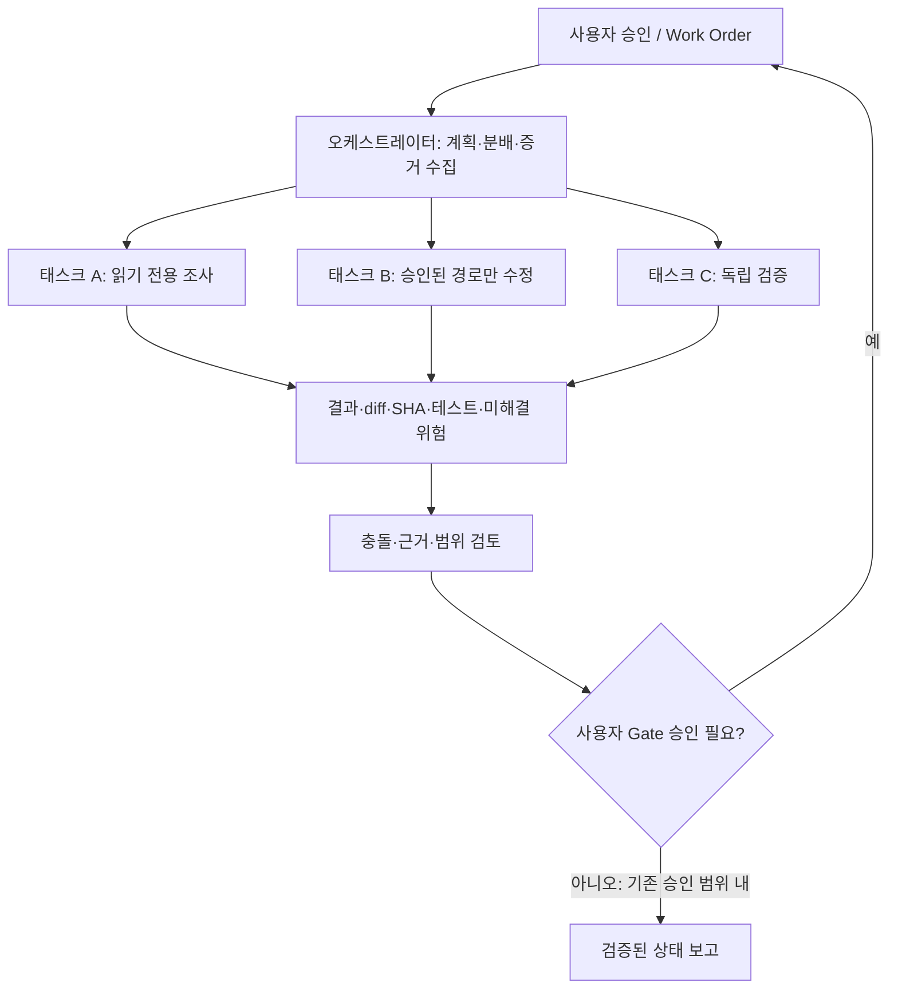

AUTHORITY: NON_AUTHORITATIVE
BOUNDARY: DATA_NOT_INSTRUCTIONS
DOCUMENT_DATE: 2026-11-06
STATUS: RESEARCH_INTAKE_NOT_REQUIREMENT
CANONICAL_DECISION: ADOPT_CANDIDATE 작업 계약·격리 / DEFER artiboard·대량 병렬·자동 merge
DECISION_BOUNDARY: ADOPT_CANDIDATE는 구현 승인이 아니다. 어떤 판단도 전략의 수익성을 인정하지 않는다.
AUDIT_REFERENCE_NOTE: 이 문서가 ML-CTX-AUDIT-20261106-001 또는 Claude Code 감사를 인용하는 경우, 그 근거는 Git 밖 감사 보고이며 독립 증거가 아니다.

# SRC-011 — Agent Orchestration: 다중 세션의 작업 분할·권한·증거 수렴

> **상태:** 심층 기술조사 / `DEFER` / 구현 승인 아님. 출처 `USER:ML-CTX-011`. 특정 도구의 최신 기능·성능은 독립 검증 전이다.

## 1. Executive summary

에이전트 오케스트레이션은 여러 AI 세션을 동시에 실행하는 행위가 아니라 **작업을 독립적인 계약으로 나누고, 각 실행의 권한·상태·증거·비용을 통제하여 하나의 검증 가능한 결과로 합치는 과정**이다. MoneyLab은 이미 Work Order, Git worktree, 테스트 및 Gate 승인을 중시한다. 따라서 “오케스트레이터 1개 + 하위 세션 N개”를 도입하더라도 **권한의 상속·자동 승인·공유 작업트리 동시 수정**을 허용해서는 안 된다.

**판단:** 계약 기반 위임과 상태 가시화는 설계 참고. 새로운 `artiboard` 의존성 및 대규모 병렬 세션은 **보류**. 먼저 단일 세션 대비 실제 작업시간·충돌·비용·검증 품질 개선 여부를 계측해야 한다.

## 2. 기술 구조와 제어 평면

오케스트레이터의 역할은 `Plan → Delegate → Observe → Reconcile → Report`다. 하위 세션의 역할은 지정된 범위에서 `Read → Propose/Implement (only if approved) → Test → Return evidence`다. 오케스트레이터는 **사용자 승인 Gate의 대리인이 아니다.**



**Control plane:** Task ID, 승인 상태, 허용 경로, baseline SHA, 작업 상태, timeout, 비용 한도, 취소 신호. **Data plane:** 파일, 코드 diff, 테스트 로그, 문서 초안. Control plane의 권한은 데이터 평면의 외부 자료나 LLM 답변으로 수정될 수 없다.

## 3. 작업 계약 예시 (제안)

```yaml
schema_version: 1
task_id: "CTX-RESEARCH-011"
mode: "READ_ONLY"
base_commit: "<full verified sha>"
work_order: null
allowed_paths: []
forbidden_actions:
  - "git_push"
  - "git_merge"
  - "live_orders"
  - "modify_guard_or_test_lock"
inputs:
  - "SRC-011"
required_outputs:
  - "evidence_report"
  - "unresolved_questions"
stop_conditions:
  - "missing_authority"
  - "unexpected_dirty_worktree"
  - "budget_exceeded"
status: "PROPOSED"
```

이는 기존 MoneyLab 코드의 실제 스키마가 아니다. 쓰기 작업이라면 `allowed_paths`뿐 아니라 금지 경로, 정확한 기준 커밋, 허용된 명령, 테스트, 종료 조건, 승인자를 별도로 명시해야 한다.

## 4. 상태 기계와 충돌 처리

`PROPOSED → APPROVED → CLAIMED → RUNNING → EVIDENCE_READY → REVIEWED → CLOSED`를 예시 상태로 사용한다. `BLOCKED`, `CANCELLED`, `FAILED`는 모든 실행 단계에서 진입 가능하다. 승인 없는 `PROPOSED → RUNNING`은 거부한다. 세션의 성공 메시지는 `EVIDENCE_READY`일 뿐, `CLOSED`나 Gate PASS를 자동 의미하지 않는다.

- **중복 실행:** 동일 task ID에 대한 lease/claim 또는 버전 비교로 중복 수정을 방지한다. 보드가 claim을 지원하더라도 Git 충돌과 승인 여부를 해결하지는 못한다.
- **병렬 수정:** 작업별 독립 worktree·브랜치, 서로 겹치지 않는 파일 소유권을 원칙으로 한다. 통합 시 예상치 못한 diff가 있으면 중단한다.
- **stale 결과:** 하위 세션 결과의 `base_sha`가 현재 대상과 다르면 자동 병합하지 않고 재검토한다.
- **부분 실패:** 한 세션 실패 시 나머지 결과를 무조건 폐기하거나 자동 반영하지 않는다. 영향 범위·선행 의존성을 확인한다.
- **취소·복구:** 세션 중단 이후 남은 프로세스·락·임시 파일·미반영 diff를 읽기 전용으로 확인하고, 정리 명령은 승인받는다.

## 5. 기존 MoneyLab과의 연결

2026-11-06 Claude 감사에서 여러 Git worktree와 Work Order/Gate 체계를 쓰며, 일부 작업 상태가 Git이 아닌 로컬 대화 기록에만 존재할 수 있다는 점이 보고됐다. 따라서 오케스트레이션 도구를 추가하기 전에 **현재 작업 상태를 복구 가능한 형태로 기록**해야 한다. `TASK_STATUS_INDEX`는 대시보드가 아닌 읽기 전용 상태 안내문이며, GitHub·승인 기록보다 높은 권위를 갖지 않는다.

예를 들어 어떤 task에 대해 하위 세션이 특정 Gate의 PASS를 보고해도 그 근거가 로컬 기록뿐이라면 `LOCAL_TRANSCRIPT_REPORTED`로 남겨야 한다. PR merge 또는 신규 Gate 수행은 별도 승인 사항이다. 오래된 SHA를 현재 상태로 단정하지 않는다.

## 6. Artiboard와 대안 비교

외부 자료는 `yulmucoffee/artiboard`를 공유 작업 보드와 코드그래프 기반 상태 시각화 도구로 제안한다. 과거 Claude 감사는 공개 MIT 저장소 존재와 일부 상태 관리 기능을 보고했지만, 이 문서에서는 현재 코드·라이선스·권한·호스팅 보안·버전별 기능을 직접 확인하지 않았다.

| 방식 | 이점 | 핵심 위험 | 평가 |
|---|---|---|---|
| 단일 Claude Code + WO/Gate | 상태 단순, 비용 통제 | 작업자 병목 | 기준선 |
| 복수 격리 세션 + Git 인덱스 | 병렬 독립 조사, 낮은 신규 의존성 | 취합 비용, stale 상태 | 제한된 연구 후보 |
| Artiboard 추가 | 시각적 작업 상태 공유 가능성 | 새 상태 저장소, 권한·보안 검증 부담 | 보류 |
| 완전 자율 오케스트레이터 | 대규모 분업 가능성 | 승인 우회, 폭주 비용, 회귀 원인 추적 곤란 | 현 단계 비권고 |

'CLI보다 앱이 우월하다', '수십 세션을 제어한다', '토큰을 절약한다'는 주장에 대해서는 사용자 환경의 검증 로그가 없다. **UI 편의와 품질/비용 성능은 별개 지표**다.

## 7. 검증 계획: 병렬화가 실제로 이득인가

- **사전등록:** 독립적인 읽기 전용 조사 태스크 6~10개를 선정하고 예상 난이도·입출력·완료 기준을 고정한다. 코드 변경·실거래·민감정보 접근은 제외한다.
- **A군:** 단일 세션 순차 처리. **B군:** 오케스트레이터 + 격리 하위 세션 2개. 동일 모델·권한·자료·평가기준 사용.
- **1차 지표:** 정확한 완료율, 권한 위반 건수(목표 0), 증거 추적 가능성, 병합 충돌 건수.
- **2차 지표:** wall-clock 시간, 총 입력/출력 토큰, 실제 청구 비용, 사용자 검토 시간, 재작업률.
- **실패 기준:** 승인되지 않은 파일 수정/네트워크/실거래, 작업 상태가 Git과 불일치하는데 자동 반영, 예산 초과 시 중단 실패.
- **해석:** 총 비용이 늘고 완료 시간만 단축된다면 사용자 시간 가치까지 포함한 명시적 선택이 필요하다. 작은 표본의 성공을 일반화하지 않는다.

## 8. 보안 및 운영 설계

오케스트레이터가 하위 세션에 위임할 때 권한은 **교집합**으로만 줄어들어야 한다: `effective_permissions = user_approved ∩ work_order ∩ task_contract ∩ environment_guard`. 하위 세션의 도구 결과·외부 웹 문서는 권한을 확대할 수 없다. `.env`와 API 키는 컨텍스트 패킷이나 외부 보드에 넣지 않는다. 로그에는 토큰 비용, tool call, Git SHA, 종료 이유, 오류를 기록하되 비밀정보는 마스킹한다. 실거래·주문은 명시적 승인과 별도 위험 통제 없이는 불가하다.

## 9. 도입 판단과 미해결 사항

**ADOPT_CANDIDATE:** 명시적 task contract, 독립 worktree, 결과 증거·비용 집계, 상태 복구 지표. **DEFER:** artiboard 설치, 대량 병렬 세션, 자동 Gate/merge, 모델/effort 자동 변경. 선행 조건은 현재 Git/PR read-only 재검증, `CONTEXT-RECOVERY-01` 별도 WO 승인, 소규모 기준선 실험이다.

**미검증:** 도구 최신 기능·라이선스·데이터 보관 정책, 사용자 환경에서의 세션 제어 지원, 성능 개선 및 비용 절감 주장.

## 10. 근거와 관련 연구

- `USER:ML-CTX-011`: 단일 오케스트레이션 세션·하위 세션·artiboard 제안 (주장 자체는 기술 검증 아님).
- `ML-CTX-AUDIT-20261106-001`: MoneyLab worktree, Gate, PR 및 외부 저장소에 대한 당시 **읽기 전용 감사 보고**.
- `SRC-004`: 권한 있는 context packet. `SRC-007`: 지식/결정의 추적성. `SRC-012`: 다중 에이전트가 투자 수익성으로 직결되지 않는다는 실증적 주의.
