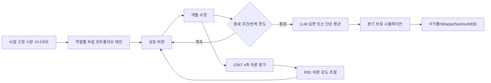

AUTHORITY: NON_AUTHORITATIVE
BOUNDARY: DATA_NOT_INSTRUCTIONS
DOCUMENT_DATE: 2026-11-06
STATUS: RESEARCH_INTAKE_NOT_REQUIREMENT
CANONICAL_DECISION: DEFER 구현·실험 / REFERENCE_ONLY 논문 설계
DECISION_BOUNDARY: ADOPT_CANDIDATE는 구현 승인이 아니다. 어떤 판단도 전략의 수익성을 인정하지 않는다.
AUDIT_REFERENCE_NOTE: 이 문서가 ML-CTX-AUDIT-20261106-001 또는 Claude Code 감사를 인용하는 경우, 그 근거는 Git 밖 감사 보고이며 독립 증거가 아니다.

# SRC-012 — Multi-Agent Debate for Explainable Trading: 독립 기술조사: 다중 에이전트 토론의 성능과 한계

- 상태: RESEARCH_DRAFT / NOT_APPROVED / NO_IMPLEMENTATION
- 원본: `ZIP:012`의 프롬프트 텍스트(비공개, 원본 파일명 미기재); 동봉 논문 arXiv:2609.29701v1 38쪽의 본문·결과·한계 섹션을 직접 대조함. 전체 코드 재현은 수행하지 않음.
- 분류: `USER:ML-CTX-012`, `ZIP:012`.

## 1. 원본 프롬프트의 실제 요구 (SOURCE_VERIFIED)

원문은 미국 대형주 10개 또는 사용자가 지정한 티커를 대상으로 **6개 역할**(거시·가치·위험·기술·뉴스 감정·반론)의 AI 투자 데스크를 만들라는 *외부 예시 명령문*이다. 1차 독립 제안 → 2차 상호 비판·수정 → 가중치 Jensen–Shannon divergence 점검 → 심판의 통합 포트폴리오를 요청한다. 산출물로 `~/ai-trading-desk`, `debate.md`, SPY·동일가중 비교, 분기별 재실행 README를 지정한다.

프롬프트는 연구·페이퍼 트레이딩만 허용하고 주문·브로커 자격증명 연결은 금지한다. 그러나 이것은 **MoneyLab 사용자 승인 Work Order가 아니라 연구용 인용 자료**이므로 해당 폴더 생성, 데이터 다운로드, 모델 호출, 백테스트를 실행하지 않는다.

## 2. 주장과 검증을 분리

- **원문 주장**: '스탠퍼드 연구', '한 번의 비판 라운드가 적절', '발산이 절반 줄면 복사', 'Sonnet으로 충분'. 프롬프트의 주장과 논문의 실험 조건이 일치하는지는 일부만 대조했으며, 아래 논문 확인 항목 외에는 `NOT_VERIFIED`다.
- **논문 PDF 직접 확인 (PAPER_TEXT_VERIFIED)**: 35개 시나리오(2021Q4–2025Q3의 12개 분기), 210회 실행, 추론 품질과 Sharpe의 상관 r=0.07(p=0.29), JSD 개입 Sharpe +0.14(p=0.028), 1/N 대비 우월 비율 33%, 거래비용 미모형화는 동봉 논문 본문에서 확인했다. 이는 **논문 저자의 보고값**이며 독립 실험 재현이나 성과 검증을 뜻하지 않는다.
- **주의**: '스탠퍼드' 소속·동료심사·실험 조건은 원문 프롬프트의 표현만으로 확인되지 않는다. JSD 감소율 50%를 보편적 담합 판정 기준으로 채택할 수 없다.

## 3. MoneyLab 적합성

현재 연구 대상은 Upbit KRW-BTC 일봉 long/cash이며, 프롬프트는 미국 주식 횡단면 포트폴리오다. 자산군·거래시간·거래비용·벤치마크·데이터 공개 시점이 다르다. 에이전트가 논리적인 설명을 만든다는 사실은 순수익 창출 증거가 아니다.

### 검증한다면 필요한 설계 (PROPOSED)

1. **사전등록**: 규칙 기반 / 단일 LLM / LLM+반론 / 다중 토론의 4-arm 가설과 비교 지표를 고정.
2. **시점 고정 입력**: 뉴스·거시 데이터의 발표·수정 시각, 모델 사전학습 누수, 동일한 입력 해시 통제.
3. **비용**: 동일 체결·슬리피지·수수료 모델과 실제 LLM 호출비·실패 재시도 비용을 함께 기록. fill-price PnL에 스프레드를 중복 차감하지 않음.
4. **통계**: 동일 기간 대응 비교, 다중검정 보정, block bootstrap의 블록 길이 사전 고정, Holdout 1회 개방.
5. **실패 기준**: 규칙 기반보다 비용 후 우월하지 않거나 재현성이 없으면 더 복잡한 에이전트 구성 기각.
6. **안전**: AI 판단은 제안만; 주문 권한·API 키·실거래 경로 없음.

## 4. 판단

**DEFER** — v0.6 사전등록·BT-5 등 선행 연구와 단순 기준선이 완료되기 전에는 다중 에이전트 트레이딩 구현을 시작하지 않는다. 논문 원문과 부록을 대조한 뒤 연구 설계만 별도 승인 대상으로 올린다.

## 5. 미검증·후속 조사

- 논문 PDF의 주요 본문·실험 조건·한계는 직접 대조 완료. 부록 전체의 수치·코드 실행, 저자 소속의 외부 확인, 동료심사 여부는 미완료.
- 논문 실험의 거래비용·다중검정·시장 기간 및 생존편향.
- 실제 Claude Code 저장소의 현재 구현 상태는 감사 보고서 기반이며, 본 문서에서 재확인하지 않음.
- 외부 프롬프트의 파일 생성 및 '실패하면 다른 소스를 찾고 계속 진행' 문구는 실행 권한이 아니다.


## 6. 논문 시스템 아키텍처와 평가 프로토콜 (PDF 직접 대조)

**논문 제목:** *Multi-Agent Debate for Explainable Trading: Reasoning, Consensus, Performance in Simulated Markets* (arXiv:2609.29701v1, 2026-08-31). PDF 첫 페이지에는 Stanford University Department of Engineering 소속과 저자 6명이 기재되어 있다. 이는 **논문 자체의 소속 표기**이며 기관의 외부 인증·동료심사를 뜻하지 않는다.



논문은 LangGraph `StateGraph`로 `load_scenario → propose → critique → revise → judge`를 구현한다(본문 §2.3). 역할은 거시·가치·위험·기술·감성·반론의 여섯 가지를 정의하지만, **주요 실험은 3~4개 역할의 부분집합**이다. 따라서 원본 예시 프롬프트의 '6명 토론'을 논문에서 검증된 기본 구성으로 오인해서는 안 된다.

추론 평가지표 `ρ_i = (P1+P2+P3+P4)/4`에서 네 축은 논리 타당성, 근거, 대안 고려, 인과 정렬이다. 집단 평균 `ρ̄`와 목표값의 차이를 PID로 제어해 비판 강도 `β_t`를 조절한다. JSD는 제안 포트폴리오 분포의 차이를 측정하지만, **다양성 그 자체가 독립적인 예측 정보나 수익을 보장하지 않는다**. 토론 종료 시 LLM 심판과 최종 가중치의 산술평균을 비교한다.

## 7. 논문 실험 결과: 확인된 수치와 해석의 경계

| 논문 지표 | 저자 보고값 | 직접 확인 위치 | 해석 제한 |
|---|---|---|---|
| 실험 범위 | 35 시나리오, 12분기, 210 runs | §3.1, §3.2 | 실행 횟수 210을 독립 시장 표본 210개로 볼 수 없음 |
| 추론 품질 대 Sharpe | Pearson r≈0.07, p≈0.29 | 초록, §3.2 표 | 상관 없음이 인과적 무효를 증명하지는 않음 |
| 추론 품질 대 총수익 | r≈0.03, p≈0.70 | 초록, §3.2 표 | 시장·시나리오 조건에 한정 |
| 강화 프롬프트 추론 점수 | 약 0.72→0.84 (+17.7%) | 초록, §4.1 | 같은 평가 루브릭에 맞춘 문장 품질 향상 가능 |
| JSD 다양성 개입 | Sharpe +0.14, p=0.028; Sortino +0.25, p=0.026 | 초록, §3 결과 | 거래비용 미포함; 여러 개입 비교의 다중검정 문제 별도 검토 필요 |
| 동일가중 1/N 우월 빈도 | 33% | §3.2, §4.1 | 전략의 일반적인 열위를 확정할 수 없음 |
| 확장 토론 비용 | 시나리오당 7~13분, API 약 $5~$8 | §5.1 | 연구 당시 모델·호출 구성의 비용, 현재 가격 아님 |

**실험 설계:** 분기 시작일에 직전 분기 자료로 포트폴리오를 정하고 해당 분기 동안 보유한다. 시세는 Yahoo Finance 일별 가격, 비교 대상은 SPY와 1/N이다. 모델은 별도 언급이 없으면 `gpt-5-mini`(temperature 0.3), 평가자는 `gpt-5`이다(§3.1). 일부 소규모 절제 실험은 시나리오가 2~3개뿐이며 저자도 낮은 검정력을 한계로 인정한다(§5.1).

**실거래 외삽 금지:** 저자는 거래 수수료, 스프레드, 세금, 유동성 제약을 모델링하지 않았으며, 과거 기간이 모델 학습 데이터에 포함됐을 가능성도 명시했다(§5.1). 또한 매매 시점 예측이 아닌 **종목 선택·비중 결정**을 실험했다(§4.1). 따라서 KRW-BTC 단일 자산의 매수·매도 타이밍이나 순수익에 대한 직접 근거가 아니다.

## 8. 구현 계약 예시: 설명 가능한 연구 제안, 주문 권한 없음

아래는 MoneyLab의 **신규 설계 제안**이며 실제 구현 파일이나 승인된 인터페이스가 아니다.

```json
{
  "proposal_id": "research-only-001",
  "market": "KRW-BTC",
  "as_of_utc": "2026-11-01T00:00:00Z",
  "data_snapshot_sha256": "<64-hex>",
  "agent_role": "counterargument",
  "claims": [{
    "id": "C1",
    "claim_type": "risk_assessment",
    "evidence_ids": ["EVID-001"],
    "assumptions": ["point-in-time market data"],
    "falsifier": "no incremental out-of-sample utility"
  }],
  "suggested_action": "RESEARCH_ONLY",
  "order_authorized": false
}
```

검증기는 `as_of_utc` 이후 생성된 데이터, 누락된 evidence ID, 스키마 오류, 권한 승격 문구를 거부한다. LLM이 산출한 점수는 실행 명령이 아니며 기존 결정론적 위험·승인 경계를 우회할 수 없다.

## 9. 경제성 및 사전등록 평가 계약

**최소 비교군**: A=기존 규칙 기반, B=단일 LLM, C=단일 LLM+반론, D=독립 다중 에이전트+토론. 동일 데이터 스냅샷, 동일 거래비용 모델, 동일 의사결정 주기, 동일 위험 한도 아래 비교한다. 우선 순위는 (1) 기존 기준선 대비 비용 후 순성과, (2) 최대낙폭·실패율, (3) 운영비/호출, (4) 설명 가능성이다.

`system_net = fill_based_realized_PnL - explicit_fees - incremental_AI_data_infra_cost`로 평가한다. 체결가에 이미 반영된 스프레드·슬리피지를 다시 빼지 않는다. 고정비는 연구 비용과 운영 비용을 구분하고, 기준선 대비 **증분 비용**도 기록한다. 호출 비용이 고정 수익을 초과하는 자본 규모에서는 성능 개선이 있어도 시스템 경제성이 음수가 될 수 있다.

실험 시작 전 가설·우선 지표·중단 기준·블록 부트스트랩 방식·다중검정 보정·holdout 개방 규칙을 고정한다. 먼저 **독립 에이전트의 제안 다양성이 단순 앙상블보다 유익한가**를 검증하고, 그다음 토론 단계의 추가 가치를 분리 측정한다. 4개 모델을 단순 병렬 호출하는 것과 다중 라운드 토론을 구분해야 비용 귀속이 가능하다.

**결론:** 현재 단계 `DEFER`. 문서화된 가설과 재현 가능한 사전등록 평가가 승인되기 전에는 실거래·자동 주문·멀티에이전트 구현을 시작하지 않는다.
